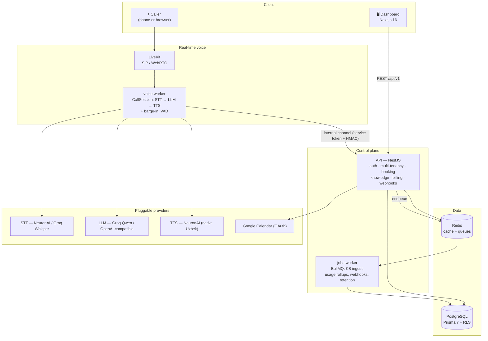
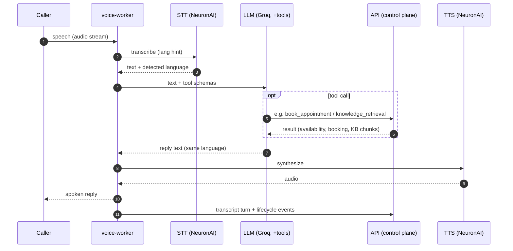

<h1 align="center">🎙️ OvozAI</h1>

<p align="center">
  <b>An AI voice receptionist that answers your phone in Uzbek, Russian &amp; English</b><br/>
  — answers from a knowledge base, books appointments, and hands off to a human when needed.
</p>

<p align="center">
  
  
  
  
  
</p>

<p align="center">
  <a href="https://ovozai-rho.vercel.app"><b>🔴 Live Demo</b></a> ·
  <a href="#-architecture">Architecture</a> ·
  <a href="#-voice-pipeline">Voice pipeline</a> ·
  <a href="#-running-locally">Run locally</a> ·
  <a href="docs/">Docs</a>
</p>

---

> **Project status:** a **portfolio / demo** project — functional end to end as a live demo, but
> **not yet production-ready**. See [**🚧 Status & what's next**](#-status--whats-next) for an honest
> list of what still needs doing.

## ✨ Live Demo

**👉 https://ovozai-rho.vercel.app**

Sign in with the demo account and try it end to end:

```
email:    demo@ovozai.uz
password: ovozai-demo
```

Then open **Agents → “Luxe Qabulxona” → Test** and either type or **speak** (🎤) to the agent in
Uzbek, Russian, or English. It greets you, answers salon questions from its knowledge base, and
books an appointment — with a real, spoken reply.

> ⚠️ **Free-tier note:** the backend sleeps after ~15 min of inactivity, so the *first* request
> after a quiet period takes ~50 seconds to wake up. A refresh fixes it. Hosted on free tiers
> (Vercel + Render + Neon) at **$0/month**.

## 📸 Screenshots

> 📷 _Best experienced live — [**try the demo**](https://ovozai-rho.vercel.app)._ To add images,
> save `landing.png`, `dashboard.png`, `test-agent.png` into `docs/screenshots/` and uncomment the
> table below.

<!--
| Landing | Dashboard | Voice Test Agent |
| --- | --- | --- |
|  |  |  |
-->


## 🚀 What it does

- 🗣️ **Multilingual voice** — Uzbek, Russian & English, with **per-turn language detection** (the
  caller can switch languages mid-call and the agent follows).
- 🎙️ **Native Uzbek speech** — real speech-to-text **and** text-to-speech via **NeuronAI** (a
  native Uzbek voice), which is dramatically more accurate on Uzbek than a generic Whisper model.
- 🧠 **Real LLM with tools** — the agent reasons and calls tools: `check_availability`,
  `book_appointment`, `reschedule_appointment`, `cancel_appointment`, `knowledge_retrieval`,
  `transfer_call`, `end_call`.
- 📅 **Appointment booking** — a real availability engine (business hours, slot length, capacity,
  lead time, lunch breaks), **conflict detection with alternative-slot suggestions**, timezone-aware
  (`Asia/Tashkent`), with optional **Google Calendar** sync (per-business OAuth).
- 📚 **Knowledge base + RAG** — agents answer from your documents; pluggable embeddings with an
  app-side cosine retriever.
- 🏢 **Multi-tenant SaaS** — strict org isolation via a Prisma **tenant extension** *and* PostgreSQL
  **Row-Level Security** (defense-in-depth), RBAC, audit logging.
- 🔐 **Auth** — short-lived access JWTs + rotating refresh tokens (reuse-detection), **argon2id**
  password hashing.
- 💳 **Billing** — plans, subscriptions, usage rollups & plan-limit enforcement.
- 🔌 **Integrations** — webhooks (HMAC-signed), notifications, calendar — all behind swappable
  provider interfaces (mock/local defaults, real adapters documented).
- 📊 **Observability & compliance** — Prometheus `/metrics`, structured PII-redacted JSON logs,
  data retention + right-to-erasure.
- ☎️ **Telephony** — real-time media over **LiveKit** (SIP/WebRTC) is wired; the live demo uses a
  browser **Test Agent** (the same `CallSession` orchestrator), so you can test instantly without a
  phone number.

## 🏗️ Architecture

A **NestJS modular monolith** for the control plane, a **separately deployable real-time voice
worker** for the media/AI loop, a **BullMQ jobs worker** for async work, and a **Next.js** dashboard —
all in a Turborepo + pnpm monorepo with shared `contracts` (zod), `database` (Prisma), `ui`, and
`integrations` packages.



**Key design decisions**

- **Tenant isolation, twice.** `prisma.tenant` auto-scopes every tenant-bound query to the active
  org (via an `AsyncLocalStorage` request context); PostgreSQL **RLS** is a second, independent guard
  — verified to block cross-tenant reads even with the app guard bypassed.
- **The voice worker never writes tenant data directly.** It reports calls, transcripts, bookings and
  usage to the API over an **authenticated internal channel** (service token + HMAC over the raw
  body), keeping all business logic and tenancy in one place.
- **Everything external is an interface.** STT/LLM/TTS, payments, calendar, notifications, storage —
  each has a provider interface with a local/mock default and real adapters, so the stack runs with
  **zero API keys** in dev and swaps to real providers via env.

See [`docs/ARCHITECTURE.md`](docs/ARCHITECTURE.md) for the full design and ADRs.

## 🎙️ Voice pipeline

Each caller turn runs speech-to-text → LLM (with tools) → text-to-speech, with barge-in support.
The agent detects the caller's language per turn and replies in it.



More detail: [`docs/VOICE_PIPELINE.md`](docs/VOICE_PIPELINE.md) · testing it:
[`docs/VOICE_TESTING.md`](docs/VOICE_TESTING.md).

## 🧰 Tech stack

| Area | Choice |
| --- | --- |
| Monorepo | Turborepo 2.11 + pnpm 12 workspaces (version **catalog**) |
| Frontend | Next.js 16 (App Router) · React 19 · Tailwind CSS 4 |
| Backend | NestJS 12 (modular monolith) + a standalone real-time voice worker |
| Database | PostgreSQL + Prisma 7 (driver-adapter model, `@prisma/adapter-pg`) + RLS |
| Cache / queues | Redis + BullMQ |
| Voice (demo) | **NeuronAI** STT + TTS (native Uzbek) · **Groq** LLM (Qwen) · **LiveKit** media |
| Language | TypeScript 5.9 (strict) |
| Tooling | ESLint (flat config) · Prettier · Vitest · Playwright |
| Hosting (demo) | **Vercel** (web) · **Render** (api + voice-worker) · **Neon** (Postgres) |

## 📦 Monorepo layout

```
.
├── apps/
│   ├── web/            # Next.js 16 — landing + full dashboard
│   ├── api/            # NestJS 12 — auth, tenancy, agents, knowledge, booking, billing, compliance
│   ├── voice-worker/   # Real-time STT→LLM→TTS orchestrator (WebSocket gateway + LiveKit transport)
│   └── jobs-worker/    # BullMQ workers — KB ingestion, usage rollups, webhooks, retention
├── packages/
│   ├── database/       # Prisma schema, migrations, generated client, seed
│   ├── contracts/      # zod schemas + shared types (the API contract)
│   ├── integrations/   # provider interfaces: STT / LLM / TTS / embeddings / calendar / payments
│   ├── ui/             # shared React components
│   └── config/         # shared tsconfig / eslint / prettier presets
├── docs/               # architecture, database, API, voice pipeline, security, compliance, roadmap
├── render.yaml         # Render Blueprint (api + voice-worker)
└── pnpm-workspace.yaml # workspaces + version catalog
```

## 🖥️ Running locally

**Prerequisites:** Node ≥ 20.9 (`.nvmrc` pins 24), pnpm 12 via Corepack, and PostgreSQL + Redis
(Docker or native). Building/testing needs no database.

```bash
corepack enable                 # enable pnpm
cp .env.example .env
pnpm install                    # if prompted about build scripts: pnpm approve-builds --all
pnpm docker:up                  # PostgreSQL + Redis (or bring your own)
pnpm db:generate
pnpm db:migrate:deploy
pnpm db:seed                    # demo org + owner + ACTIVE Uzbek agent + FAQ knowledge base
pnpm dev                        # web + api + workers in watch mode
```

Open **http://localhost:3000** (web) and **http://localhost:3001/api/v1/health** (API liveness).
For the real Uzbek voice, set the `VOICE_*` provider env (see [`docs/VOICE_TESTING.md`](docs/VOICE_TESTING.md)).

## ☁️ Deployment

The live demo runs entirely on free tiers:

- **Web** → Vercel (Next.js, root `apps/web`).
- **API + voice-worker** → Render (two web services, defined in [`render.yaml`](render.yaml)).
- **PostgreSQL** → Neon.

The Render Blueprint auto-deploys on push to `main`; secrets (DB URL, provider keys) live in the
Render dashboard, never in the repo. Full write-up: [`docs/DEPLOYMENT_GUIDE.md`](docs/DEPLOYMENT_GUIDE.md).

## 🚧 Status & what's next

This is a **portfolio project** — built to demonstrate a complete, realistic AI-voice SaaS. It works
**end to end as a live demo**, but it is **not a finished, production-ready product**. An honest list
of what still remains:

- **Real telephony.** The LiveKit media transport is wired and unit-tested, but no SIP trunk or phone
  number is provisioned — the demo answers calls through the **browser Test Agent**, not real inbound
  PSTN calls. Live Uzbekistan numbers require a licensed local operator.
- **Free-tier demo trade-offs.** The public demo skips **Redis + the jobs-worker** (the knowledge
  base is pre-seeded instead of ingested live), **Google Calendar OAuth** isn't configured on the
  demo server (bookings fall back to a mock sync), and the free services **cold-start (~50 s)** after
  idle.
- **Voice quality & latency.** Uzbek STT/TTS via NeuronAI is solid, but per-language voice selection
  (RU/EN), barge-in tuning, and end-to-end latency are still being improved.
- **Retrieval.** The knowledge base uses a local lexical embedder; **pgvector + semantic embeddings**
  are the planned upgrade for larger document sets.
- **Real business providers.** Payments (Stripe) and some integrations ship as mock / documented
  adapters rather than live connections.
- **Production hardening.** No external penetration test, SOC 2 evidence, at-scale load numbers, or
  in-country data-residency placement yet — these are tracked as boundaries in
  [`docs/COMPLIANCE.md`](docs/COMPLIANCE.md) and [`docs/PRODUCTION_READINESS.md`](docs/PRODUCTION_READINESS.md).

In short: **a working, demonstrable system with a clear path to production — a work in progress, not
a shipped commercial product.**

## 🧪 Scripts

| Command | What it does |
| --- | --- |
| `pnpm dev` | Run all apps in watch mode |
| `pnpm build` · `pnpm typecheck` · `pnpm lint` · `pnpm test` | Build / typecheck / lint / unit-test the monorepo |
| `pnpm --filter @ovozai/api test:e2e` | API e2e (boots the app, no DB needed) |
| `pnpm db:migrate:deploy` · `pnpm db:seed` · `pnpm db:studio` | Apply migrations · seed demo data · open Prisma Studio |

## 📚 Documentation

| Doc | Contents |
| --- | --- |
| [`ARCHITECTURE.md`](docs/ARCHITECTURE.md) | System design, components, ADRs |
| [`VOICE_PIPELINE.md`](docs/VOICE_PIPELINE.md) | Real-time call flow, providers, latency |
| [`DATABASE.md`](docs/DATABASE.md) | Data model, multi-tenancy, migrations, PII |
| [`API.md`](docs/API.md) | REST conventions, auth, errors, endpoints |
| [`SECURITY.md`](docs/SECURITY.md) · [`COMPLIANCE.md`](docs/COMPLIANCE.md) | AuthN/Z, tenant isolation, RLS, retention, residency |
| [`DEPLOYMENT_GUIDE.md`](docs/DEPLOYMENT_GUIDE.md) · [`ROADMAP.md`](docs/ROADMAP.md) | Deploying the stack · phased delivery plan |

---

<p align="center">
  Built by <a href="https://github.com/jaloliddinrakhmatov">Jaloliddin Rakhmatov</a> ·
  a portfolio project — all rights reserved.
</p>
