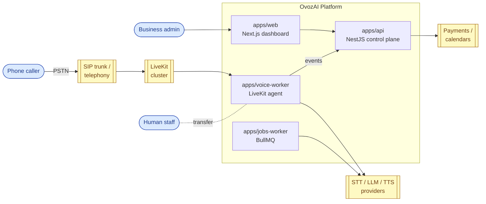
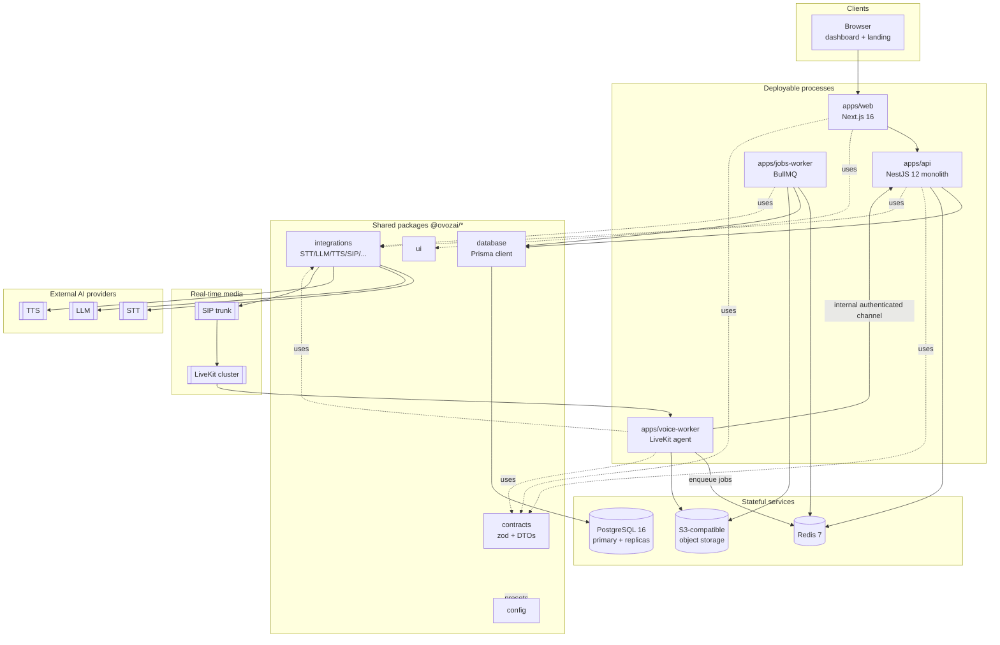
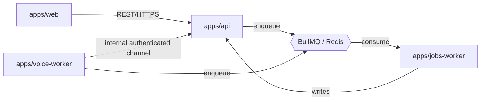
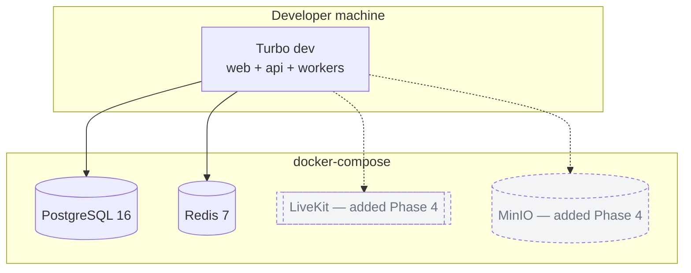
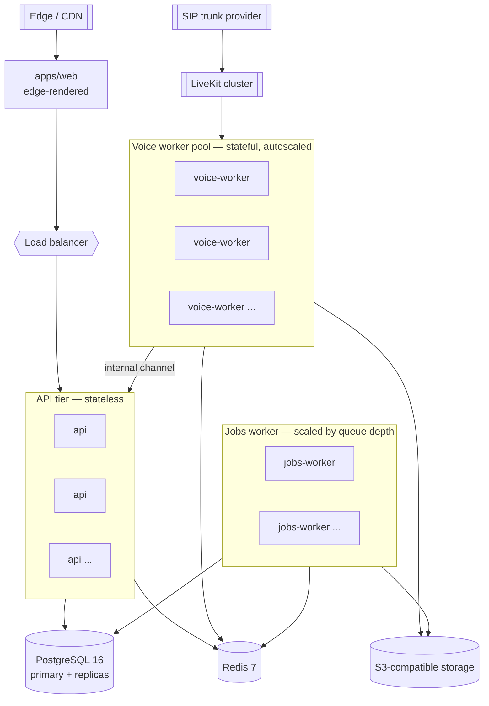

# OvozAI — System Architecture

> **Status:** Living document · **Last updated:** 2026-10-21 · **Current phase:** Phase 1 (Development foundation)

OvozAI is a production-grade, multi-tenant, AI-powered **Voice Receptionist SaaS** for businesses in Uzbekistan. Businesses configure AI voice agents that answer inbound phone calls, converse in **Uzbek, Russian, and English**, answer customer questions from a knowledge base, book appointments, and transfer calls to human staff. The platform is built as a **modular monolith** control plane (NestJS) surrounded by two independently deployable workers — a **real-time voice worker** (a LiveKit agent process) and an **async background jobs worker** (BullMQ) — all sharing code through a Turborepo + pnpm monorepo. This document describes the system's structure, boundaries, cross-cutting concerns, deployment topology, risks, and the key architecture decisions behind it.

Related documents:

- [`docs/ROADMAP.md`](./ROADMAP.md) — phased delivery plan and exit criteria
- [`docs/DATABASE.md`](./DATABASE.md) — Prisma schema, multi-tenancy columns, migrations
- [`docs/API.md`](./API.md) — REST surface, DTOs, contracts
- [`docs/VOICE_PIPELINE.md`](./VOICE_PIPELINE.md) — end-to-end real-time voice loop
- [`docs/SECURITY.md`](./SECURITY.md) — authn/z, data privacy, compliance
- [`CLAUDE.md`](../CLAUDE.md) — repository conventions for AI-assisted development

---

## 1. Overview & Goals

OvozAI replaces or augments a business's front-desk phone line with an AI agent that is always available, multilingual, and grounded in the business's own information. The architectural goals, in priority order:

1. **Ship vertical slices fast** with a small team — favour one deployable backend and shared code over premature service sprawl.
2. **Isolate the real-time media path** so that latency-sensitive voice sessions never compete with, or are destabilised by, the request/response control plane.
3. **Stay provider-agnostic** for STT/LLM/TTS so the platform can adapt to the realities of low-resource Uzbek speech technology (multi-provider, fallback, custom vocabulary).
4. **Enforce strict multi-tenant isolation** from day one via an `organizationId` on every tenant-scoped row.
5. **Design for Uzbekistan compliance** (data localization, recording consent, retention) as a first-class concern, not an afterthought.

---

## 2. System Context

The platform sits between three groups of actors and a set of external providers.

| Actor / System | Role | Interacts with |
| --- | --- | --- |
| **Business admins** (OWNER/ADMIN/MEMBER/VIEWER) | Configure organizations, agents, knowledge base, phone numbers, billing | `apps/web` dashboard → `apps/api` REST |
| **Phone callers** (end customers) | Dial the business's number; speak to the AI agent | PSTN/SIP → LiveKit → `apps/voice-worker` |
| **Human staff** | Receive warm/cold transfers from the AI agent | `apps/voice-worker` → SIP transfer |
| **External AI providers** | STT, LLM, TTS | `packages/integrations` adapters |
| **Telephony provider** | SIP trunk, Uzbekistan number provisioning | LiveKit SIP ingress / `integrations` |
| **Payment & calendar providers** | Subscriptions, usage billing, appointment sync | `integrations` (Phase 6) |

---

## 3. Monorepo Layout

A single **Turborepo + pnpm workspaces** repository under the `@ovozai/*` package scope. Incremental builds, a single lockfile, and shared TypeScript code across every runtime.

| Path | Package | Responsibility |
| --- | --- | --- |
| `apps/web` | `@ovozai/web` | Next.js 16 (App Router) marketing landing + customer dashboard. TypeScript, Tailwind v4, shadcn/ui. |
| `apps/api` | `@ovozai/api` | NestJS 12 modular monolith — the business backend / control plane. |
| `apps/voice-worker` | `@ovozai/voice-worker` | LiveKit real-time voice agent. Joins LiveKit rooms, runs the STT→LLM→TTS loop. |
| `apps/jobs-worker` | `@ovozai/jobs-worker` | BullMQ background processor — transcription post-processing, embeddings, notifications, usage rollups. |
| `packages/database` | `@ovozai/database` | Prisma schema + generated client + migrations + seed. |
| `packages/contracts` | `@ovozai/contracts` | zod schemas + shared DTO/types + typed API contract used by web/api/workers. |
| `packages/ui` | `@ovozai/ui` | shadcn/ui-based shared React component library. |
| `packages/config` | `@ovozai/config` | Shared `tsconfig` / ESLint (flat) / Prettier presets. |
| `packages/integrations` | `@ovozai/integrations` | Provider-agnostic adapters: STT, LLM, TTS, telephony/SIP, calendar, payments, storage. |

### Dependency direction

- `packages/*` never import from `apps/*`.
- `apps/*` depend on `packages/*`; apps do not import from one another.
- `packages/contracts` is the shared vocabulary: it depends on nothing but zod, and everything else may depend on it.
- `packages/integrations` depends on `contracts` for its typed inputs/outputs and exposes only interfaces + concrete adapters — consumers program against the interface, never a specific vendor SDK.

---

## 4. Pinned Stack Versions

Verified mutually compatible on **2026-10-21**. Treat this table as authoritative; see the ADRs in §11 for the two intentional "not-latest" pins.

| Area | Choice |
| --- | --- |
| Runtime | Node `>=20.9` (dev on 24.12) |
| Package manager | pnpm `12.14` |
| Build orchestration | Turborepo `2.11` |
| Language | TypeScript `5.9.3` (pinned — see ADR-001) |
| Web | Next.js `16.4` + React `19.3`, Tailwind CSS `4.3` + shadcn/ui |
| Backend | NestJS `12.2` (+ `@nestjs/terminus` 12.1 for health, `@nestjs/config` 12) |
| ORM | Prisma `7.10.1` (pinned — see ADR-002) |
| Database | PostgreSQL `16` |
| Cache / queues | Redis `7`, BullMQ `6` + ioredis `6` |
| Validation | zod `4.6` |
| Linting / format | ESLint `10.13` (flat config) + typescript-eslint `8.72`, Prettier `3.9` |
| Testing | Vitest `5` + Playwright `1.64` |
| Real-time voice | LiveKit (server SDK + agents framework) |
| Object storage | S3-compatible |

---

## 5. Container / Component View

The diagram below shows the four deployable processes, the shared packages they consume, and the stateful backing services and external providers.

**Reading the diagram.** Solid arrows are runtime calls / data flows; dotted arrows are compile-time dependencies on shared packages. The only process that keeps long-lived stateful sessions is `apps/voice-worker`; everything else in the request path (`api`, `jobs-worker`) is horizontally scalable and effectively stateless between requests/jobs.

---

## 6. NestJS Backend — Module Responsibilities

The control plane is a modular monolith. Each module is a **bounded context** with a single clear responsibility and an explicit public surface (controllers + exported services). Modules communicate in-process through injected services, never by reaching into one another's repositories. This discipline is what keeps a future extraction to a separate service cheap.

> **Phase 1 implements only** `health`, plus the application skeleton, `config`, and Prisma wiring. The remaining modules are introduced in later phases (see [`docs/ROADMAP.md`](./ROADMAP.md)).

| Module | Bounded context | Introduced |
| --- | --- | --- |
| `health` | Liveness/readiness probes via `@nestjs/terminus`; reports DB/Redis connectivity | Phase 1 |
| `auth` | JWT access + refresh tokens, login/refresh/logout, principal resolution | Phase 2 |
| `organizations` | Tenants; lifecycle of an organization | Phase 2 |
| `memberships` | user↔org links with a role; membership verification | Phase 2 |
| `users` | User identity, profile, credentials | Phase 2 |
| `api-keys` | Programmatic access keys scoped to an organization | Phase 2 |
| `agents` | AI agent configuration and versioned definitions | Phase 3 |
| `knowledge-base` | Documents → chunks → embeddings; retrieval | Phase 3 |
| `customers` | End-customer records per tenant | Phase 3 |
| `appointments` | Booking, scheduling, status | Phase 3 |
| `calls` | Call history, transcripts, recording metadata | Phase 4 |
| `phone-numbers` | Telephony number provisioning and routing | Phase 5 |
| `integrations` | Configuration of external providers per tenant | Phase 5–6 |
| `billing` | Plans, subscriptions, usage metering | Phase 6 |
| `notifications` | Outbound notifications (email/SMS/in-app) | Phase 6 |
| `audit-log` | Append-only record of security-relevant actions | Phase 2 |
| `webhooks` | Inbound/outbound webhook handling | Phase 5–6 |

Each module typically contains: a controller (HTTP surface), a service (business logic), a Prisma-backed repository access layer, zod-validated DTOs imported from `@ovozai/contracts`, and guards/decorators for authz. Cross-module needs are satisfied by importing another module's **exported service**, keeping the dependency graph explicit and acyclic.

---

## 7. Cross-Cutting Concerns

### 7.1 Configuration

`@nestjs/config` loads environment variables, validated at boot against a **zod schema** from `@ovozai/contracts`. The app refuses to start if required configuration is missing or malformed — fail fast, never fail silently. Every environment variable is documented in `.env.example`; no secrets are committed. Each deployable (`api`, `voice-worker`, `jobs-worker`) owns its own config schema but reuses shared fragments (database URL, Redis URL, LiveKit credentials).

### 7.2 Validation

**zod is the single source of truth** for shape and constraint. Request DTOs, external-provider responses, queue job payloads, and the internal voice→api event channel are all validated against zod schemas defined once in `@ovozai/contracts` and shared across web, api, and workers. Types are inferred from the schemas (`z.infer`), so the compile-time type and the runtime check can never drift apart.

### 7.3 Authentication & Authorization

- **Authn:** JWT **access + refresh** tokens issued by the `auth` module. API keys provide programmatic access for server-to-server callers.
- **Authz:** NestJS **guards + decorators** enforce the RBAC roles **OWNER, ADMIN, MEMBER, VIEWER** (with **AGENT_OPERATOR** reserved for the future). A route declares its required role via a decorator; a guard resolves the principal, verifies org membership, and checks the role.
- Internal process-to-process calls (voice-worker → api) use a dedicated authenticated internal channel (service credential), never a user JWT.

### 7.4 Multi-Tenancy

- **Model:** shared database + shared schema. Every tenant-scoped table carries an `organizationId` foreign key. See [`docs/DATABASE.md`](./DATABASE.md).
- **Enforcement:** a **Prisma Client extension** injects and validates `organizationId` on reads and writes, so a query can never silently cross tenants. The active tenant is resolved from the authenticated principal's **active-organization claim** and verified against `memberships`.
- **Defense in depth (later):** PostgreSQL **Row-Level Security (RLS)** is documented as a hardening step for Phase 7 — the application-layer extension is the primary control; RLS is the backstop.

### 7.5 Logging & Error Handling

- **Structured JSON logs** with a correlation/request id propagated across HTTP and into queued jobs and voice events, so a single call can be traced end-to-end.
- A **global exception filter** maps domain errors to stable, typed error responses (shape defined in `@ovozai/contracts`); unexpected errors are logged with context and returned as opaque 5xx responses — internal details never leak to clients.
- Workers use idempotent handlers and BullMQ's retry/backoff so transient failures self-heal; poison messages land on a dead-letter path for inspection.

### 7.6 Observability

Health endpoints via `@nestjs/terminus` from Phase 1. Full observability — distributed **tracing, metrics, and centralized logs** across api, voice-worker, and jobs-worker — is built out in Phase 7, including latency SLOs for the voice path and queue-depth metrics that drive jobs-worker autoscaling.

### 7.7 Testing

- **Unit + integration tests** with **Vitest** across all packages and apps.
- **End-to-end** browser tests with **Playwright** for the web dashboard and the landing page's backend-connection status.
- Contract tests validate that DTOs on both sides of a boundary agree with the shared zod schemas in `@ovozai/contracts`.
- A baseline automated test suite exists from Phase 1 and grows with every vertical slice; CI runs the Turborepo task graph so only affected packages are tested on each change.

---

## 8. Service Boundaries & Inter-Service Communication

Three distinct communication mechanisms, chosen per boundary:

1. **REST (synchronous, user-facing).** `apps/web` → `apps/api` over HTTPS. Request/response DTOs are the zod contracts in `@ovozai/contracts`; see [`docs/API.md`](./API.md). This is the only client-facing surface.

2. **Internal authenticated channel (voice-worker → api).** The voice worker emits **call lifecycle events** (call started/answered/ended, transcript segments, tool invocations, transfer outcomes) to the control plane over an authenticated internal channel using a service credential, not a user token. Payloads are zod-validated. This keeps the real-time process decoupled from the dashboard's auth model and lets the api remain the single writer of authoritative call records.

3. **BullMQ queues on Redis (asynchronous).** Work that must not block a request or a live call is enqueued to Redis and consumed by `apps/jobs-worker`: transcription post-processing, embedding generation for the knowledge base, notifications, and usage rollups. The jobs-worker scales by **queue depth**. Both api and voice-worker can enqueue; only jobs-worker consumes.

**Why these three.** REST fits the interactive dashboard. The internal channel keeps latency-sensitive media work off the user auth path and preserves a single source of truth for call data. Queues absorb bursty, retryable, latency-tolerant work and decouple producers from consumers, which is exactly the profile of post-call processing and embeddings.

---

## 9. Deployment Topology

### 9.1 Development (docker-compose)

In **Phase 1**, local development runs the apps via Turborepo with **PostgreSQL + Redis** in `docker-compose`. **LiveKit and MinIO** (S3-compatible) are added to the compose file when the voice MVP begins (Phase 4).

### 9.2 Production

Stateless tiers scale horizontally behind a load balancer; the voice worker is a stateful, autoscaled pool; jobs-worker scales by queue depth. PostgreSQL runs primary + read replicas.

**Data-residency note.** Per the Uzbekistan "On Personal Data" law (No. ZRU-547), personal data of Uzbek citizens — including call recordings and transcripts — must be stored on servers located in Uzbekistan. The production topology is designed so that the PII-bearing stores (PostgreSQL, S3 recordings/transcripts) can be pinned to in-country infrastructure. This is formalized in Phase 7; see §10 and [`docs/SECURITY.md`](./SECURITY.md).

---

## 10. Scalability, Reliability & Risks

### 10.1 Scalability

- **api** — stateless; scale horizontally behind the LB. Read-heavy queries served from PostgreSQL replicas.
- **voice-worker** — one agent process handles a bounded number of concurrent live sessions; scale the pool out as concurrency rises. Its separation from the api means a traffic spike on the dashboard cannot degrade live-call latency, and vice versa (**latency isolation**).
- **jobs-worker** — scale by **queue depth**; back-pressure is natural and visible.
- **Redis / PostgreSQL** — vertical plus read-replica scaling; connection pooling tuned per tier.

### 10.2 Reliability

- Health/readiness probes gate rollout and load-balancer membership.
- Workers are idempotent with retry/backoff and dead-lettering.
- The api is the single writer of authoritative call records; the voice path degrades gracefully (fallback providers, graceful call termination) rather than corrupting state.
- Multi-provider AI adapters allow failover when a single STT/LLM/TTS vendor degrades.

### 10.3 Risks

1. **Uzbek STT quality.** Uzbek is a **low-resource language** with few high-quality providers and frequent **Uzbek↔Russian code-switching**. Mitigation: provider-agnostic STT adapters with **fallback**, **custom vocabulary**, and **WER measurement** from the first voice slice; measure early and continuously (Phase 4 onward, hardened in Phase 5).
2. **SIP / telephony in Uzbekistan.** Carrier and number provisioning, **regulatory licensing**, and media concerns (latency, NAT traversal, codec negotiation). Mitigation: telephony behind an adapter; validate provisioning and transfer flows in Phase 5 with a real trunk.
3. **Data privacy & localization.** Law **No. ZRU-547** mandates in-country storage of Uzbek citizens' personal data; **call recordings and transcripts are sensitive PII** requiring **recording consent** and defined **retention**. Mitigation: data-residency-aware topology, consent capture in the voice flow, retention policies, and RLS — consolidated in Phase 7. See [`docs/SECURITY.md`](./SECURITY.md).

---

## 11. Architecture Decision Records

Each ADR records **Context / Decision / Consequences**. ADRs are immutable once accepted; a superseding decision gets a new record.

### ADR-001 — Pin TypeScript to 5.9.3 (not 7.x)

- **Context.** TypeScript 7.x is available, but the monorepo's typed-lint toolchain `typescript-eslint@8.72` declares a peer range of `typescript >=4.8.4 <6.1.0`. Adopting TS 7 now would break type-aware static analysis across every package.
- **Decision.** Pin TypeScript to **5.9.3** repo-wide.
- **Consequences.** Static analysis stays reliable across the monorepo today. We forgo TS 7 language features for now. **Revisit** when `typescript-eslint` ships support for TS 7; the pin is a single coordinated bump via `packages/config`.

### ADR-002 — Pin Prisma to 7.10.1 (stable, not the RC `latest`)

- **Context.** npm's `latest` tag for Prisma currently resolves to `8.0.0-rc.24`, a **release candidate**. OvozAI is a production data foundation.
- **Decision.** Pin Prisma to the stable **7.10.1**.
- **Consequences.** We trade the newest Prisma 8 features for a production-grade, supported baseline and predictable migrations. Revisit once Prisma 8 reaches a stable GA and is validated against our schema and the `organizationId` client extension.

### ADR-003 — Modular monolith over microservices (for the control plane)

- **Context.** A small team must deliver quickly while keeping future optionality. Microservices add operational overhead (deploys, networking, distributed data) that is unjustified at this stage.
- **Decision.** Build the business backend as a **single NestJS modular monolith** — one deploy — with each module a bounded context and **clean, explicit module boundaries** (services communicate in-process via injected, exported services; no cross-module repository access).
- **Consequences.** Faster iteration, simpler local dev and deploy, one transaction boundary. Discipline is required to keep boundaries clean. Because boundaries are explicit, a hot module can later be **extracted** into its own service with limited churn.

### ADR-004 — Separate the real-time voice worker from the API

- **Context.** Live media sessions are **long-lived and stateful**, with a very different runtime profile from the request/response control plane, and are extremely latency-sensitive.
- **Decision.** Run the voice agent as a **separate deployable** (`apps/voice-worker`) that joins LiveKit rooms and runs the STT→LLM→TTS loop, communicating with the api over an **internal authenticated channel**.
- **Consequences.** **Latency isolation** (dashboard traffic cannot destabilise calls), independent **horizontal scaling** of the stateful pool, and independent deploy cadence. Cost: a second runtime to operate and an explicit internal event contract to maintain. The api remains the single source of truth for call records.

### ADR-005 — Provider-agnostic AI adapters

- **Context.** Uzbek STT is low-resource; no single vendor is reliably best, and code-switching demands flexibility and fallback. Vendor lock-in is a strategic risk.
- **Decision.** Define **provider-agnostic interfaces** for STT, LLM, TTS (and telephony, calendar, payments, storage) in `@ovozai/integrations`; consumers depend only on the interface.
- **Consequences.** We can add providers, run **fallback chains**, A/B compare WER, and swap vendors without touching business logic. Cost: an abstraction layer to maintain and per-provider adapter work. This directly mitigates Risk #1 (§10.3).

### ADR-006 — Turborepo + pnpm monorepo

- **Context.** Four runtimes and five shared packages must share types (notably the zod contracts) and ship consistently.
- **Decision.** Use a **Turborepo + pnpm workspaces** monorepo under `@ovozai/*` with a single lockfile and incremental, cached task graph.
- **Consequences.** Shared code (contracts, database client, UI) is consumed without publishing; CI builds/tests only affected packages; one lockfile keeps versions coherent. Cost: monorepo tooling and task-graph configuration to maintain.

---

## 12. Glossary

| Term | Meaning |
| --- | --- |
| **Control plane** | The NestJS api — configuration, auth, tenancy, authoritative data. |
| **Voice worker** | The LiveKit agent process running the live STT→LLM→TTS loop. |
| **Tenant / organization** | A business customer; the unit of row-level data isolation. |
| **Barge-in** | Caller interrupting the agent's speech; handled via VAD in the voice pipeline. |
| **WER** | Word Error Rate — the primary STT quality metric for Uzbek tuning. |
| **RLS** | PostgreSQL Row-Level Security — Phase 7 defense-in-depth for tenancy. |
| **ZRU-547** | Uzbekistan Law "On Personal Data" driving data-localization requirements. |

See [`docs/VOICE_PIPELINE.md`](./VOICE_PIPELINE.md) for the full real-time flow and [`docs/SECURITY.md`](./SECURITY.md) for the compliance model.
