# OvozAI — Database Design

> Data model, persistence conventions, and multi-tenancy strategy for the OvozAI
> platform.
>
> **Status:** Target initial data model (Phase 1 ships a core subset — see
> [Phase-1 Scope](#phase-1-initial-migration-scope)).
> **Last updated:** 2026-10-21

Related documents:

- [docs/ARCHITECTURE.md](./ARCHITECTURE.md) — system topology, monorepo layout, module boundaries.
- [docs/API.md](./API.md) — REST surface that reads and writes this model.
- [docs/VOICE_PIPELINE.md](./VOICE_PIPELINE.md) — how `Call`, `Transcript`, and `CallEvent` are produced by the voice worker.
- [docs/SECURITY.md](./SECURITY.md) — PII handling, encryption, and Uzbekistan data-localization obligations.
- [docs/ROADMAP.md](./ROADMAP.md) — phase plan referenced throughout this document.

---

## 1. Technology Choice

| Concern | Choice | Notes |
| --- | --- | --- |
| Database engine | **PostgreSQL 16** | Primary system of record for all tenant and platform data. |
| ORM / schema toolkit | **Prisma 7.10.1** | Type-safe client, declarative schema, migration engine. |
| Schema location | `packages/database/prisma/schema.prisma` | Single source of truth, consumed across `apps/*`. |
| Generated client | `@ovozai/database` | Re-exports a configured, tenant-aware Prisma Client (see §4). |
| Cache / queues | **Redis 7** | Not a system of record; BullMQ queues, rate-limit counters, ephemeral session state. |
| Object storage | **S3-compatible** | Call recordings and uploaded knowledge documents live here; the DB stores only object keys and metadata. |
| Vector search | **pgvector (deferred)** | Embedding storage decision is deferred to Phase 3 — see [KnowledgeChunk](#knowledgechunk). |

PostgreSQL 16 was chosen for strong relational integrity (the model is
highly relational), mature JSON(B) support for semi-structured `config`/`payload`
columns, row-level security for the Phase-7 hardening path, and first-class
support in the Prisma 7 migration engine. The `pgvector` extension keeps a future
semantic-search path inside the same database without introducing a second store.

### 1.1 Package placement

The database package is a workspace package in the Turborepo + pnpm monorepo
(scope `@ovozai/*`). It owns:

```
packages/database/
  prisma/
    schema.prisma        # the model documented here
    migrations/          # generated, committed, immutable once merged
    seed.ts              # idempotent seed (plans, demo org in non-prod)
  src/
    client.ts            # PrismaClient factory + tenant extension (see §4)
    index.ts             # public exports: db types, enums, tenant client
```

`packages/contracts` (zod 4.6) derives request/response shapes that mirror — but
are intentionally decoupled from — these persistence models. The API never
returns raw Prisma rows; it maps to contract DTOs.

---

## 2. Migration Workflow

Migrations are generated from `schema.prisma`, committed to the repository, and
applied forward-only in every environment.

| Environment | Command | Behavior |
| --- | --- | --- |
| Local dev | `pnpm --filter @ovozai/database prisma migrate dev` | Diffs the schema, creates a new migration, applies it, regenerates the client. |
| CI (verify) | `prisma migrate diff` / `prisma validate` | Fails the build if the committed migrations do not reproduce the schema. |
| Staging / Prod | `pnpm --filter @ovozai/database prisma migrate deploy` | Applies only already-committed migrations; never generates or edits. Runs as a release step before new app code goes live. |
| Client generation | `prisma generate` | Runs on install and in CI; output is the typed `@ovozai/database` client. |

Rules:

- **Never** edit a migration after it has merged to the main branch. Correct a
  mistake with a new forward migration.
- `migrate dev` is a **development-only** command; it may reset the dev database.
  It is never run against staging or production.
- Destructive changes (drop column, narrow a type) are split into expand →
  migrate data → contract migrations to keep deploys zero-downtime.
- Each migration is reviewed for a matching `organizationId` index on any new
  tenant-scoped table (see §5.5).

### 2.1 Seeding

`prisma/seed.ts` is **idempotent** (uses `upsert`) and seeds:

- The platform **`Plan`** catalog (e.g. `free`, `starter`, `growth`) — safe in all
  environments, including production.
- In **non-production only**: a demo `Organization`, an `OWNER` `User`, and a
  sample `Agent`, to support local development and E2E tests.

Seeds never fabricate PII in production and never seed customer/call data.

---

## 3. Multi-Tenancy Data Strategy

OvozAI is a **multi-tenant SaaS** using a **shared database + shared schema**
model. The tenant is the **`Organization`**.

- Every tenant-scoped table carries a non-null **`organizationId`** foreign key to
  `Organization`.
- A small set of **global** tables are *not* tenant-scoped: `User` (identity is
  global; a user may belong to many organizations via `Membership`), `Plan`
  (platform-wide catalog), and the join table `Membership` itself (which *carries*
  `organizationId` as part of its composite identity).
- Tenant isolation is enforced in the **application layer** by a Prisma Client
  extension (§4) that injects and validates `organizationId` on every query.
- **PostgreSQL Row-Level Security (RLS)** is documented as a later
  **defense-in-depth** hardening step (**Phase 7**) — see §4.3. It is *additive*;
  the application-layer guard remains the primary control.

### 3.1 Tenant resolution

The active tenant is resolved from the **authenticated principal's
active-organization claim** (carried in the JWT, or bound to an API key), then
**verified against `Membership`** before any query runs. A principal can never
select an organization they are not a member of. See
[docs/API.md](./API.md#authentication--authorization) for how the claim is issued
and validated at the edge.

### 3.2 RBAC

Roles are stored on **`Membership`** (the user↔organization join) as the
`MembershipRole` enum: `OWNER`, `ADMIN`, `MEMBER`, `VIEWER` (future
`AGENT_OPERATOR`). Enforcement is via NestJS guards at the API layer, not in the
database. The data model only *stores* the role; it does not interpret it.

---

## 4. The Tenant-Scoping Prisma Client Extension

Isolation is enforced by a Prisma Client extension that wraps every model query.
It is the single most important piece of the data layer: **no tenant-scoped read
or write may run without an `organizationId` in scope.**

### 4.1 Concept

A request-scoped context carries the resolved `organizationId`. The extension:

1. **Injects** `organizationId` into the `where` clause of every `find*`,
   `update*`, `delete*`, `count`, and `aggregate` on a tenant-scoped model.
2. **Injects** `organizationId` into `data` on every `create`/`createMany`.
3. **Validates** that any client-supplied `organizationId` matches the context —
   a mismatch throws before the query reaches PostgreSQL.
4. **Skips** global models (`User`, `Plan`) that have no `organizationId`.

### 4.2 Illustrative snippet

> Conceptual only — not the production implementation. The real extension reads
> the tenant from an `AsyncLocalStorage` context populated by a NestJS
> interceptor.

```ts
// packages/database/src/client.ts (illustrative)
import { PrismaClient } from '@prisma/client';
import { tenantContext } from './tenant-context';

const TENANT_SCOPED = new Set([
  'Agent', 'AgentVersion', 'KnowledgeBase', 'KnowledgeDocument',
  'KnowledgeChunk', 'Customer', 'Appointment', 'PhoneNumber', 'Call',
  'CallEvent', 'Transcript', 'TranscriptTurn', 'Integration',
  'Subscription', 'UsageRecord', 'ApiKey', 'WebhookEndpoint',
  'WebhookDelivery', 'AuditLog',
]);

export const db = new PrismaClient().$extends({
  query: {
    $allModels: {
      async $allOperations({ model, operation, args, query }) {
        if (!model || !TENANT_SCOPED.has(model)) return query(args);

        const organizationId = tenantContext.getStore()?.organizationId;
        if (!organizationId) {
          throw new Error(`Tenant context missing for ${model}.${operation}`);
        }

        // Reads / targeted writes: force the tenant filter.
        if ('where' in args) {
          args.where = { ...args.where, organizationId };
        }
        // Creates: stamp the tenant, reject spoofed values.
        if ('data' in args && args.data && !Array.isArray(args.data)) {
          if (
            'organizationId' in args.data &&
            args.data.organizationId !== organizationId
          ) {
            throw new Error('organizationId mismatch: cross-tenant write blocked');
          }
          args.data.organizationId = organizationId;
        }
        return query(args);
      },
    },
  },
});
```

### 4.3 Future RLS hardening (Phase 7)

As defense-in-depth, Phase 7 will add PostgreSQL RLS so the database itself
rejects cross-tenant access even if the application guard is bypassed:

- Enable `ROW LEVEL SECURITY` on every tenant-scoped table.
- A `USING (organization_id = current_setting('app.current_org')::uuid)` policy.
- The API sets `app.current_org` via `SET LOCAL` at the start of each transaction,
  from the same resolved tenant context.
- The application connects as a non-superuser role so policies are enforced.

RLS does **not** replace the extension; both run together. See
[docs/SECURITY.md](./SECURITY.md) for the full hardening plan.

---

## 5. Conventions

### 5.1 Primary keys

- Every table uses an application-generated **UUID v7** primary key:
  `id String @id @default(dbgenerated("uuid_generate_v7()")) @db.Uuid`
  (CUID2 is the fallback if a UUID-v7 generator is unavailable; the project
  standardizes on one — **UUID** — and does not mix).
- UUIDs are opaque to clients and safe to expose in URLs and API payloads.

### 5.2 Timestamps & soft deletes

- Every table has **`createdAt`** (`@default(now())`) and **`updatedAt`**
  (`@updatedAt`), stored as `timestamptz`.
- Tables whose rows are user-managed and recoverable carry **`deletedAt`**
  (nullable `timestamptz`) for **soft deletes**: `Organization`, `User`, `Agent`,
  `KnowledgeBase`, `KnowledgeDocument`, `Customer`, `PhoneNumber`, `Integration`,
  `WebhookEndpoint`, `ApiKey`.
- Append-only / ledger tables are **never** soft-deleted: `Call`, `CallEvent`,
  `Transcript`, `TranscriptTurn`, `UsageRecord`, `AuditLog`, `WebhookDelivery`.
- The tenant extension (§4) also appends `deletedAt: null` to reads of
  soft-deletable models unless a query explicitly opts out.

### 5.3 Naming: camelCase client, snake_case columns

The Prisma client uses **camelCase**; physical columns and tables use
**snake_case** via `@map` / `@@map`:

```prisma
model Membership {
  id             String   @id @default(dbgenerated("uuid_generate_v7()")) @db.Uuid
  organizationId String   @map("organization_id") @db.Uuid
  userId         String   @map("user_id") @db.Uuid
  role           MembershipRole @default(MEMBER)
  invitedAt      DateTime @default(now()) @map("invited_at")
  acceptedAt     DateTime? @map("accepted_at")
  createdAt      DateTime @default(now()) @map("created_at")
  updatedAt      DateTime @updatedAt @map("updated_at")

  organization   Organization @relation(fields: [organizationId], references: [id], onDelete: Cascade)
  user           User         @relation(fields: [userId], references: [id], onDelete: Cascade)

  @@unique([organizationId, userId])
  @@index([organizationId])
  @@map("memberships")
}
```

### 5.4 Enums

Enums are defined in the Prisma schema and map to native PostgreSQL enum types.
See §7 for the full catalog.

### 5.5 Indexing strategy

- **Every tenant-scoped table is indexed on `organizationId`.** Because the
  extension injects it into every `where`, it is the highest-value index.
- **Composite indexes** cover the common lookups, with `organizationId` as the
  leading column, e.g.:
  - `Customer @@index([organizationId, phoneE164])`
  - `Call @@index([organizationId, status, startedAt])`
  - `Appointment @@index([organizationId, startsAt])`
  - `UsageRecord @@index([organizationId, metric, periodKey])`
  - `CallEvent @@index([callId, occurredAt])`
- **Unique constraints** enforce business rules, scoped by tenant where
  appropriate: `Membership @@unique([organizationId, userId])`,
  `PhoneNumber @@unique([e164])`, `Organization @@unique([slug])`,
  `User @@unique([email])`, `Plan @@unique([code])`.

### 5.6 Foreign keys & on-delete behavior

| Relationship | onDelete | Rationale |
| --- | --- | --- |
| `Membership → Organization` / `User` | `Cascade` | Removing a tenant or user removes their memberships. |
| `ApiKey`, `Agent`, `KnowledgeBase`, `Customer`, `PhoneNumber`, `Integration`, `WebhookEndpoint` → `Organization` | `Cascade` | Deleting a tenant removes all tenant-owned config. |
| `Call`, `CallEvent`, `Transcript`, `UsageRecord`, `AuditLog` → `Organization` | `Restrict` | Ledger/audit data is retained; hard tenant deletion is a deliberate, archived operation. |
| `Call → Agent` / `PhoneNumber` / `Customer` | `SetNull` | A call record survives the deletion of the agent/number/customer it referenced. |
| `Appointment → Customer` | `Restrict` | An appointment must keep its customer reference. |
| `Appointment → Agent` / `Call` | `SetNull` | Optional references. |
| `AgentVersion → Agent` | `Cascade` | Versions belong to their agent. |
| `KnowledgeDocument → KnowledgeBase`; `KnowledgeChunk → KnowledgeDocument` | `Cascade` | Chunks/documents are owned by their parent. |
| `Subscription → Plan` | `Restrict` | A plan in use cannot be deleted. |
| `WebhookDelivery → WebhookEndpoint` | `Cascade` | Deliveries belong to their endpoint. |

### 5.7 Money & usage quantities

- **Monetary** amounts are stored as **integer minor units** (e.g. `priceCents`,
  `costCents`) with an accompanying ISO-4217 `currency` string. UZS has no minor
  unit in practice, so "cents" means the smallest billed unit the pricing engine
  uses; the field name is kept for cross-currency consistency and the scale is
  documented per currency.
- **Usage** quantities (`UsageRecord.quantity`) are stored as `Decimal` (or
  integer where the metric is inherently whole, e.g. `llm_tokens`) to avoid
  floating-point drift when metering and aggregating for billing.
- No monetary or usage value is ever stored as a floating-point type.

---

## 6. Data Classification & PII

Tables are classified to drive encryption, access control, retention, and
Uzbekistan data-localization decisions (see [docs/SECURITY.md](./SECURITY.md)).
OvozAI processes personal data of callers and users; such data is stored on
infrastructure located to satisfy Uzbekistan's data-localization requirements,
and recording/transcript access is audited.

| Table | Classification | Notes |
| --- | --- | --- |
| `User` | **PII** | Email, name, hashed password, login metadata. |
| `Customer` | **PII** | Caller phone (E.164), optional name/email, notes, tags. |
| `Call` | **PII** | From/to numbers, timing, recording object key. |
| `CallEvent` | **PII (payload)** | Lifecycle payloads may contain caller utterances/metadata. |
| `Transcript` / `TranscriptTurn` | **Sensitive PII** | Verbatim conversation content. Highest-sensitivity text. |
| Recording (S3 object, keyed from `Call.recordingObjectKey`) | **Sensitive PII** | Audio stored in object storage; DB holds only the key + metadata. |
| `ApiKey` | **Secret** | Only a hash + prefix are stored; never the raw key. |
| `Integration.secretRef` | **Secret** | A reference to a secret in the secrets manager — never the secret itself. |
| `AuditLog` | **Operational (may embed PII)** | Actor/IP and action metadata. |
| `Agent`, `AgentVersion`, `KnowledgeBase`, `KnowledgeDocument`, `KnowledgeChunk` | **Business config / content** | Knowledge content may contain tenant-confidential material. |
| `Organization`, `Plan`, `Subscription`, `UsageRecord`, `PhoneNumber`, `Appointment`, `WebhookEndpoint`, `WebhookDelivery` | **Business / operational** | Low direct PII, but tenant-confidential. |

Controls summarized (full detail in SECURITY.md): passwords hashed with Argon2id;
API keys and webhook secrets stored hashed/referenced; recordings and transcripts
access-audited; retention windows configurable per tenant; `deletedAt` soft
delete followed by a hard-delete/anonymization job for right-to-erasure requests.

---

## 7. Enum Catalog

```prisma
enum OrganizationStatus { ACTIVE TRIALING PAST_DUE SUSPENDED CANCELED }

enum MembershipRole { OWNER ADMIN MEMBER VIEWER } // AGENT_OPERATOR reserved (future)

enum AgentStatus { DRAFT ACTIVE PAUSED ARCHIVED }

enum Language { UZ RU EN } // defaultLanguage / call language

enum KnowledgeBaseStatus { ACTIVE DISABLED }

enum KnowledgeDocumentStatus { PENDING PROCESSING READY FAILED }

enum KnowledgeSourceType { UPLOAD URL TEXT FAQ }

enum CallDirection { INBOUND OUTBOUND }

enum CallStatus {
  QUEUED RINGING IN_PROGRESS COMPLETED
  FAILED NO_ANSWER BUSY CANCELED TRANSFERRED
}

enum AppointmentStatus { PENDING CONFIRMED CANCELED COMPLETED NO_SHOW }

enum PhoneNumberStatus { ACTIVE INACTIVE PORTING RELEASED }

enum TranscriptRole { CALLER AGENT SYSTEM TOOL }

enum IntegrationType { CALENDAR CRM PAYMENTS TELEPHONY }

enum IntegrationStatus { CONNECTED DISCONNECTED ERROR }

enum SubscriptionStatus { TRIALING ACTIVE PAST_DUE CANCELED INCOMPLETE }

enum UsageMetric { CALL_MINUTES STT_SECONDS TTS_CHARS LLM_TOKENS }

enum AuditActorType { USER API_KEY SYSTEM }

enum WebhookStatus { ACTIVE DISABLED }

enum WebhookDeliveryStatus { PENDING SUCCEEDED FAILED }

enum ApiKeyStatus { ACTIVE REVOKED EXPIRED }
```

---

## 8. Target Entity-Relationship Diagram

```mermaid
erDiagram
    Organization ||--o{ Membership : "has members"
    User ||--o{ Membership : "joins via"
    Organization ||--o{ ApiKey : "issues"
    Organization ||--o{ Agent : "owns"
    Agent ||--o{ AgentVersion : "versioned by"
    Organization ||--o{ KnowledgeBase : "owns"
    Agent ||--o| KnowledgeBase : "optionally bound to"
    KnowledgeBase ||--o{ KnowledgeDocument : "contains"
    KnowledgeDocument ||--o{ KnowledgeChunk : "split into"
    Organization ||--o{ Customer : "has"
    Organization ||--o{ Appointment : "schedules"
    Customer ||--o{ Appointment : "books"
    Agent ||--o{ Appointment : "handles"
    Organization ||--o{ PhoneNumber : "provisions"
    Agent ||--o{ PhoneNumber : "routed to"
    Organization ||--o{ Call : "records"
    Agent ||--o{ Call : "answers"
    PhoneNumber ||--o{ Call : "received on"
    Customer ||--o{ Call : "party to"
    Call ||--o{ CallEvent : "emits"
    Call ||--o| Transcript : "produces"
    Transcript ||--o{ TranscriptTurn : "composed of"
    Call ||--o| Appointment : "may create"
    Organization ||--o{ Integration : "configures"
    Plan ||--o{ Subscription : "billed as"
    Organization ||--o| Subscription : "subscribes via"
    Organization ||--o{ UsageRecord : "meters"
    Call ||--o{ UsageRecord : "attributed to"
    Organization ||--o{ AuditLog : "logs"
    Organization ||--o{ WebhookEndpoint : "registers"
    WebhookEndpoint ||--o{ WebhookDelivery : "delivers"

    Organization {
        uuid id PK
        string slug UK
        OrganizationStatus status
        Language defaultLanguage
        string externalCustomerId "billing ref"
    }

    User {
        uuid id PK
        string email UK
        string hashedPassword
        datetime lastLoginAt
    }

    Membership {
        uuid id PK
        uuid organizationId FK
        uuid userId FK
        MembershipRole role
    }

    ApiKey {
        uuid id PK
        uuid organizationId FK
        string hashedKey
        string prefix
        ApiKeyStatus status
    }

    Agent {
        uuid id PK
        uuid organizationId FK
        AgentStatus status
        Language defaultLanguage
        string transferNumber "E.164"
        json config
    }

    AgentVersion {
        uuid id PK
        uuid agentId FK
        int version
        datetime publishedAt
    }

    KnowledgeBase {
        uuid id PK
        uuid organizationId FK
        uuid agentId FK "nullable"
        KnowledgeBaseStatus status
    }

    KnowledgeDocument {
        uuid id PK
        uuid knowledgeBaseId FK
        uuid organizationId FK
        KnowledgeSourceType sourceType
        KnowledgeDocumentStatus status
    }

    KnowledgeChunk {
        uuid id PK
        uuid documentId FK
        uuid organizationId FK
        int ordinal
        vector embedding "pgvector; Phase 3 (deferred)"
    }

    Customer {
        uuid id PK
        uuid organizationId FK
        string phoneE164
        string email "nullable"
    }

    Appointment {
        uuid id PK
        uuid organizationId FK
        uuid customerId FK
        uuid agentId FK "nullable"
        uuid callId FK "nullable"
        AppointmentStatus status
        datetime startsAt
    }

    PhoneNumber {
        uuid id PK
        uuid organizationId FK
        string e164 UK
        uuid agentId FK "nullable"
        PhoneNumberStatus status
    }

    Call {
        uuid id PK
        uuid organizationId FK
        uuid agentId FK "nullable"
        uuid phoneNumberId FK "nullable"
        uuid customerId FK "nullable"
        CallDirection direction
        CallStatus status
        string recordingObjectKey "S3 key"
        Language language
    }

    CallEvent {
        uuid id PK
        uuid callId FK
        uuid organizationId FK
        string type
        datetime occurredAt
    }

    Transcript {
        uuid id PK
        uuid callId FK
        uuid organizationId FK
        Language language
    }

    TranscriptTurn {
        uuid id PK
        uuid transcriptId FK
        uuid organizationId FK
        TranscriptRole role
        int startMs
    }

    Integration {
        uuid id PK
        uuid organizationId FK
        IntegrationType type
        IntegrationStatus status
        string secretRef
    }

    Plan {
        uuid id PK
        string code UK
        int priceCents
        string currency
    }

    Subscription {
        uuid id PK
        uuid organizationId FK
        uuid planId FK
        SubscriptionStatus status
        datetime currentPeriodEnd
    }

    UsageRecord {
        uuid id PK
        uuid organizationId FK
        UsageMetric metric
        decimal quantity
        uuid callId FK "nullable"
        string periodKey "e.g. 2026-10"
    }

    AuditLog {
        uuid id PK
        uuid organizationId FK "nullable"
        AuditActorType actorType
        string action
    }

    WebhookEndpoint {
        uuid id PK
        uuid organizationId FK
        string url
        WebhookStatus status
    }

    WebhookDelivery {
        uuid id PK
        uuid organizationId FK
        uuid endpointId FK
        WebhookDeliveryStatus status
        int attempts
    }
```



---

## 9. Entity Reference

Legend: **PK** primary key · **FK** foreign key · fields marked *(opt)* are
nullable. All tenant-scoped tables carry `organizationId` and the `@@index`
described in §5.5; all tables carry `createdAt`/`updatedAt` unless noted.

### Organization

The **tenant** root. Everything else hangs off it.

- `id` PK, `name`, `slug` (unique, URL-safe), `status` (`OrganizationStatus`).
- Locale defaults: `locale` (BCP-47, default `uz-UZ`), `defaultLanguage`
  (`Language`), `timezone` (default `Asia/Tashkent`).
- Billing refs: `externalCustomerId` (billing provider id); the active plan is
  reached via `Subscription`.
- `deletedAt` for soft delete; hard deletion is an archived, deliberate operation.

### User

Global identity. Not tenant-scoped; a user reaches organizations through
`Membership`.

- `id` PK, `email` (unique), `hashedPassword` (Argon2id), `name`, `status`,
  `lastLoginAt`, `deletedAt`.
- **PII.** See SECURITY.md for credential handling and session rotation.

### Membership

Join table of `User` ↔ `Organization`; carries the RBAC role.

- `id` PK, `organizationId` FK, `userId` FK, `role` (`MembershipRole`),
  `invitedAt`, `acceptedAt`.
- `@@unique([organizationId, userId])` — a user has at most one membership per
  org.

### ApiKey

Server-to-server credential for an organization.

- `id` PK, `organizationId` FK, `name`, `hashedKey` (only the hash is stored),
  `prefix` (shown in UI for identification), `scopes` (string array),
  `status` (`ApiKeyStatus`), `lastUsedAt`, `expiresAt`, `revokedAt`.
- The raw key is shown exactly once at creation. Auth flow in
  [docs/API.md](./API.md#authentication--authorization).

### Agent

A configured AI voice receptionist.

- `id` PK, `organizationId` FK, `name`, `status` (`AgentStatus`),
  `defaultLanguage` (`Language`), `systemPrompt`, `voiceId`, `greeting`,
  `transferNumber` (E.164 for human handoff), `config` (JSON — model params,
  tool toggles, business hours).
- Relates to `AgentVersion` (immutable published snapshots).

### AgentVersion

An immutable, published snapshot of an agent's configuration.

- `id` PK, `agentId` FK, `version` (monotonic int per agent), `config` (JSON
  snapshot), `publishedAt`. Append-only (no `updatedAt`/`deletedAt`).

### KnowledgeBase

A collection of documents an agent answers from.

- `id` PK, `organizationId` FK, `agentId` FK *(opt)* (an org-level KB may be
  shared), `name`, `status` (`KnowledgeBaseStatus`).

### KnowledgeDocument

A source document ingested into a knowledge base.

- `id` PK, `knowledgeBaseId` FK, `organizationId` FK (denormalized for tenant
  scoping), `title`, `sourceType` (`KnowledgeSourceType`), `sourceUri`,
  `status` (`KnowledgeDocumentStatus`), `bytes`, `checksum` (dedupe / change
  detection).

### KnowledgeChunk

A retrievable fragment of a document for RAG.

- `id` PK, `documentId` FK, `organizationId` FK, `ordinal` (position in doc),
  `content`, `tokenCount`.
- `embedding`: **deferred.** The target design stores embeddings as a
  **`pgvector`** column on this table. Whether to use pgvector in-database versus
  a dedicated external vector store is a **Phase-3 (or later) decision** and is
  intentionally left open here; until then the column is omitted and retrieval is
  not wired. See [docs/VOICE_PIPELINE.md](./VOICE_PIPELINE.md) for the retrieval
  path.

### Customer

A caller/contact known to an organization. **PII.**

- `id` PK, `organizationId` FK, `phoneE164`, `name` *(opt)*, `email` *(opt)*,
  `locale`, `notes` *(opt)*, `tags` (string array), `lastContactedAt`.
- `@@index([organizationId, phoneE164])` — primary lookup path on inbound calls.

### Appointment

A booking created by an agent or by staff.

- `id` PK, `organizationId` FK, `customerId` FK, `agentId` FK *(opt)*,
  `callId` FK *(opt)* (the call that produced it), `startsAt`, `endsAt`,
  `status` (`AppointmentStatus`), `title`, `notes` *(opt)*,
  `externalCalendarId` *(opt)* (id in a connected calendar integration).

### PhoneNumber

A provisioned telephony number routed to an agent.

- `id` PK, `organizationId` FK, `e164` (globally unique), `provider`,
  `providerNumberId`, `agentId` FK *(opt)*, `status` (`PhoneNumberStatus`),
  `capabilities` (string array, e.g. `voice`, `sms`).

### Call

The central record of a phone interaction. **PII.** Append-only after it ends.

- `id` PK, `organizationId` FK, `agentId` FK *(opt)*, `phoneNumberId` FK *(opt)*,
  `customerId` FK *(opt)*, `direction` (`CallDirection`), `status`
  (`CallStatus`), `fromE164`, `toE164`, `startedAt`, `answeredAt` *(opt)*,
  `endedAt` *(opt)*, `durationSec`, `endedReason` *(opt)*,
  `recordingObjectKey` *(opt)* (S3 key — the audio is not in the DB),
  `costCents` *(opt)*, `language` (`Language`).

### CallEvent

Append-only lifecycle events for a call (ringing, answered, tool-call, transfer,
hangup, …).

- `id` PK, `callId` FK, `organizationId` FK, `type`, `payload` (JSON),
  `occurredAt`. `@@index([callId, occurredAt])`. Written primarily by the voice
  worker via the internal API (Phase 4).

### Transcript

One transcript per call.

- `id` PK, `callId` FK (effectively 1:1), `organizationId` FK, `language`
  (`Language`), `fullText` *(opt)* (denormalized convenience; the authoritative
  content is the ordered `TranscriptTurn` rows). **Sensitive PII.**

### TranscriptTurn

The **primary** representation of transcript content — one row per utterance.

- `id` PK, `transcriptId` FK, `organizationId` FK, `role` (`TranscriptRole`:
  `CALLER` | `AGENT` | `SYSTEM` | `TOOL`), `text`, `startMs`, `endMs`,
  `confidence` *(opt)*. Append-only. **Sensitive PII.**

### Integration

A third-party connection configured by a tenant.

- `id` PK, `organizationId` FK, `type` (`IntegrationType`:
  `CALENDAR` | `CRM` | `PAYMENTS` | `TELEPHONY`), `provider`, `status`
  (`IntegrationStatus`), `config` (JSON, non-secret settings),
  `secretRef` (pointer into the secrets manager — never the secret itself).

### Plan

Platform-wide billing plan catalog. **Global (not tenant-scoped).**

- `id` PK, `code` (unique, e.g. `starter`), `name`, `priceCents`, `currency`
  (ISO-4217), `limits` (JSON — included minutes, agent count, KB size, etc.).

### Subscription

An organization's active plan.

- `id` PK, `organizationId` FK (effectively one active per org),
  `planId` FK, `status` (`SubscriptionStatus`), `currentPeriodStart`,
  `currentPeriodEnd`, `externalCustomerId`, `externalSubscriptionId`.

### UsageRecord

Metered usage for billing and quota enforcement. Append-only ledger.

- `id` PK, `organizationId` FK, `metric` (`UsageMetric`:
  `CALL_MINUTES` | `STT_SECONDS` | `TTS_CHARS` | `LLM_TOKENS`), `quantity`
  (`Decimal`), `callId` FK *(opt)* (attribution), `occurredAt`,
  `periodKey` (billing-period bucket, e.g. `2026-10`).
- `@@index([organizationId, metric, periodKey])` for fast aggregation.

### AuditLog

Security/compliance audit trail. Append-only.

- `id` PK, `organizationId` FK *(opt)* (null for platform-level actions),
  `actorType` (`AuditActorType`: `USER` | `API_KEY` | `SYSTEM`),
  `actorId` *(opt)*, `action`, `targetType`, `targetId` *(opt)*,
  `metadata` (JSON), `ip` *(opt)*.

### WebhookEndpoint

A tenant-registered destination for outbound event notifications.

- `id` PK, `organizationId` FK, `url`, `events` (string array of subscribed
  types), `secret` (used to sign deliveries — stored hashed/referenced),
  `status` (`WebhookStatus`).

### WebhookDelivery

A single delivery attempt record. Append-only.

- `id` PK, `organizationId` FK, `endpointId` FK, `event`, `payload` (JSON),
  `status` (`WebhookDeliveryStatus`), `attempts`, `lastAttemptAt`. Retries are
  driven by `apps/jobs-worker` (BullMQ). Signing is described in
  [docs/API.md](./API.md#webhooks-outbound).

---

## 10. Phase-1 Initial Migration Scope

Phase 1 implements only the health endpoints, the app skeleton, Prisma wiring,
and the **initial migration**. The full model above is the **target** data
model; it is **not** all created in Phase 1.

The recommended Phase-1 initial migration is the **minimal core subset** that
proves the migration pipeline and the tenant foundation end to end:

| Included in Phase 1 | Why |
| --- | --- |
| `Organization` | The tenant root; required by the tenant extension. |
| `User` | Global identity. |
| `Membership` | Proves the user↔org join and RBAC storage. |
| Enums `OrganizationStatus`, `MembershipRole` | Exercise native enum migration. |

This subset is enough to validate `prisma migrate dev` → `migrate deploy`, the
generated `@ovozai/database` client, and the tenant-scoping extension against a
real schema. Everything else in §8–§9 (`Agent`, `Call`, `Transcript`, billing,
knowledge base, webhooks, …) lands in later phases per
[docs/ROADMAP.md](./ROADMAP.md). The `pgvector` embedding decision for
`KnowledgeChunk` and the RLS hardening (Phase 7) are explicitly out of Phase-1
scope.
