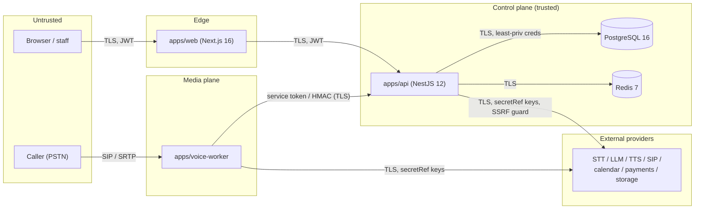
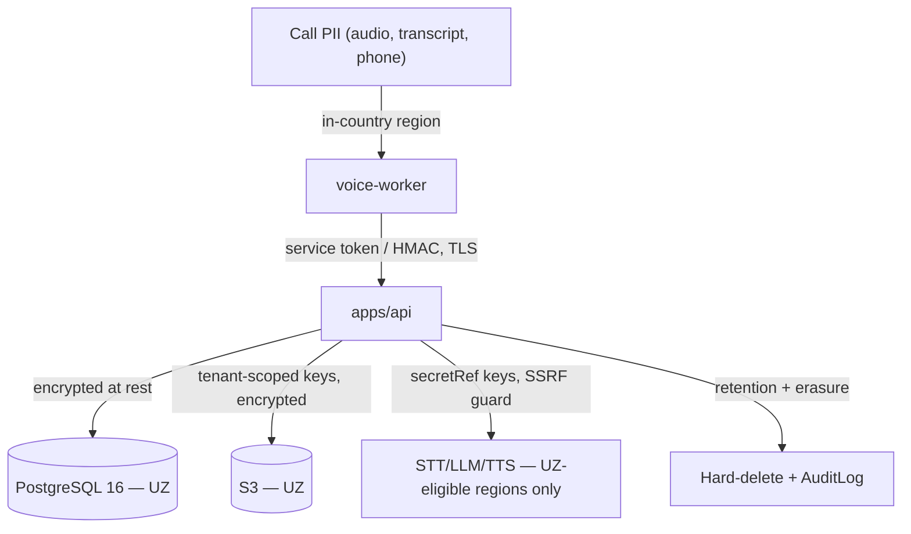

# OvozAI — Security

> Security architecture, threat model, and controls for the OvozAI multi-tenant AI Voice
> Receptionist SaaS. Security and privacy are product requirements, not add-ons: calls carry
> sensitive PII and Uzbek data-localization law is a hard architectural constraint.

**Audience:** every engineer. Treat this as the baseline all code must satisfy.
**Status:** design specification (greenfield). Controls land across phases — see §14 and
[ROADMAP.md](./ROADMAP.md).

**Related documents**

- [ARCHITECTURE.md](./ARCHITECTURE.md) — apps, planes, trust boundaries, deployment topology.
- [DATABASE.md](./DATABASE.md) — tenant columns, `Integration.secretRef`, `AuditLog`, cascade deletes.
- [API.md](./API.md) — auth endpoints, guards, rate limits, webhook signing.
- [VOICE_PIPELINE.md](./VOICE_PIPELINE.md) — recording consent, internal voice-worker ↔ API channel, PII in transcripts.
- [ROADMAP.md](./ROADMAP.md) — phase plan referenced by the checklist in §14.

---

## 1. Threat model summary

### 1.1 Assets (what we protect)

| Asset | Sensitivity | Notes |
| --- | --- | --- |
| **Tenant business data** | High | Agent configs, knowledge bases, appointments, customers. Multi-tenant — isolation is paramount. |
| **Call recordings & transcripts** | Very high (PII) | Voice + text of real people; subject to Uzbek data-localization and consent law. |
| **Credentials & sessions** | High | User passwords, JWTs, refresh tokens, API keys, service tokens. |
| **Provider API keys / integration credentials** | High | STT/LLM/TTS, telephony/SIP, calendar, payments, storage. Compromise = cost + data exposure. |
| **Phone numbers** | High (PII) | Callers' and businesses' numbers; also a toll-fraud target. |

### 1.2 Principals

- **Customers' staff** — OWNER/ADMIN/MEMBER/VIEWER of a tenant organization (see §3).
- **Callers** — the public dialing in; untrusted input source (audio, DTMF).
- **OvozAI operators** — staff/SRE; privileged, must be least-privilege and audited.
- **Attackers** — external (credential stuffing, SSRF, toll-fraud), malicious tenants (cross-tenant
  access attempts), and compromised provider/supply-chain paths.

### 1.3 Trust boundaries

The four boundaries that get the most scrutiny: **web ↔ api** (public, token-authenticated),
**api ↔ db** (least-privilege DB creds, no raw secrets), **voice-worker ↔ api** (service
token / HMAC, not user JWTs), and **api ↔ external providers** (outbound; SSRF guard, keys from
the secret store).

---

## 2. Authentication

| Mechanism | Where | Design |
| --- | --- | --- |
| **JWT access token** | web ↔ api | Short TTL (e.g. ~15 min). Signed, carries `userId`, `organizationId`, role. Never a long-lived token. |
| **Refresh token** | web ↔ api | Longer-lived, **rotating** (one-time use; rotation detects reuse/theft). Stored hashed; revocable. |
| **Password hashing** | api | **argon2id** with sane memory/time parameters. Never plaintext, never fast hashes (no MD5/SHA/bcrypt-only). |
| **Session / refresh revocation** | api + Redis | Revocation list / token-version so logout, password change, and suspected theft invalidate tokens immediately. |
| **API keys** | api (programmatic access) | **Hashed at rest**, shown once on creation, **prefixed** (identify + fast lookup, e.g. `ovk_live_…`), **scoped** to permissions and org. |
| **Service tokens / HMAC** | voice-worker ↔ api | The internal channel uses a service token and/or HMAC request signing — **not** user JWTs. Scoped to internal event/transcript endpoints only. See [VOICE_PIPELINE.md](./VOICE_PIPELINE.md). |
| **Webhook signing** | api → tenant endpoints | Outbound webhooks signed **HMAC-SHA256** with a per-tenant secret + timestamp; receivers verify to reject forgeries/replays. |

**Rules**

- Refresh-token rotation with reuse detection: a replayed (already-rotated) refresh token revokes
  the whole chain and flags the session.
- Access tokens stay short; authorization decisions re-check role/claims server-side, never trust
  the client.
- Credentials and brute-force protection → §9 (rate limiting / lockout).

---

## 3. Authorization & RBAC

Roles (tenant-scoped): **OWNER, ADMIN, MEMBER, VIEWER**.

| Role | Intent |
| --- | --- |
| `OWNER` | Full control of the organization, incl. billing, members, deletion. |
| `ADMIN` | Manage agents, integrations, members (except ownership transfer). |
| `MEMBER` | Day-to-day: manage agents/knowledge, view calls/transcripts. |
| `VIEWER` | Read-only: dashboards, call history, transcripts. |

- Enforced with NestJS **guards** (authn guard → tenant guard → role guard) on every protected
  route; see [API.md](./API.md). Authorization is deny-by-default.
- **Principle of least privilege:** each role grants the minimum needed; destructive actions
  (delete org, rotate keys, export PII) are restricted to OWNER/ADMIN and audited (§8).
- Role is never taken from the request body; it is resolved from the authenticated principal and
  the target organization membership.

---

## 4. Multi-tenant isolation

Cross-tenant data access is the highest-severity bug class in a multi-tenant SaaS. Defense in
depth:

1. **`organizationId` on every tenant-scoped row.** Non-nullable, indexed. Part of the schema
   contract in [DATABASE.md](./DATABASE.md).
2. **Prisma client-extension enforcement.** A Prisma client extension injects/asserts the current
   `organizationId` on reads and writes for tenant-scoped models, so application queries cannot
   accidentally span tenants. The tenant context is derived from the authenticated principal, not
   from user input.
3. **PostgreSQL Row-Level Security (RLS) — Phase 7 defense-in-depth.** RLS policies keyed on the
   session's org enforce isolation *at the database* even if an application query is wrong. This
   is the belt-and-suspenders layer added in Phase 7 (see §14 and [ROADMAP.md](./ROADMAP.md)); it
   does not replace the application-layer guard, it backstops it.
4. **Guard against IDOR / cross-tenant access.** Every object lookup is scoped by
   `organizationId`; never fetch by primary key alone for tenant-scoped resources. Return 404 (not
   403) for objects outside the tenant to avoid existence leaks.
5. **Tenant-scoped object storage keys.** S3 keys are prefixed by `organizationId` (e.g.
   `org/<organizationId>/calls/<callId>/recording.opus`). Bucket policies / signed URLs are scoped
   so one tenant cannot read another's recordings. The voice-worker/jobs-worker store only the key
   on the `Call`; see [VOICE_PIPELINE.md](./VOICE_PIPELINE.md#recording--transcript-handling).

---

## 5. Secrets management

- **Never hardcode secrets.** No secrets in source, config committed to git, client bundles, or
  logs.
- **`.env` for local dev only.** `.env.example` is committed (documents required variables with
  placeholder values); `.env` is **gitignored** and never contains real staging/prod secrets.
- **Secret store for staging/prod.** Use a managed secrets manager / cloud KMS secret store;
  applications read secrets at boot/runtime from it, not from files baked into images.
- **Provider API keys & integration credentials encrypted at rest.** Stored with **envelope
  encryption** (a KMS-managed data key encrypts the credential; the data key is itself encrypted).
  Rows reference credentials by **`secretRef`**, not the plaintext value — see the `Integration`
  table in [DATABASE.md](./DATABASE.md). The decrypted value is only ever held in memory at point
  of use.
- **Rotation.** Keys/secrets are rotatable without code changes (indirection via `secretRef` +
  secret store); rotation is an audited action (§8).

---

## 6. Data protection

- **TLS 1.2+ everywhere.** All service-to-service and client traffic over TLS 1.2+ (prefer 1.3).
  **Media is encrypted too:** SIP signaling and **SRTP** for the audio path — see
  [VOICE_PIPELINE.md](./VOICE_PIPELINE.md).
- **Encryption at rest.** PostgreSQL 16 and S3-compatible object storage encrypted at rest;
  backups encrypted as well (§13).
- **PII data classification.** Classify and tag sensitive data so controls and retention can be
  applied by class:

  | Class | Examples |
  | --- | --- |
  | Identity | users (staff), customers of the tenant |
  | Voice/content PII | call recordings, transcripts / `TranscriptTurn` |
  | Contact PII | phone numbers (callers, customers, transfer targets) |
  | Credentials | password hashes, API key hashes, provider `secretRef` |

- **Field-level encryption** for the most sensitive fields where warranted (beyond at-rest disk
  encryption), so a database read alone does not expose them.
- **Tokenization of phone numbers where possible** — store a token/reference and keep the raw
  number in a protected vault, limiting exposure in logs, analytics, and general queries.

---

## 7. Uzbekistan compliance

OvozAI processes personal data of Uzbek citizens, which makes the Uzbekistan Law **"On Personal
Data" (No. ZRU-547)** a **hard architectural constraint**, not a policy footnote.

### 7.1 Data localization (hard constraint)

- Personal data of Uzbek citizens must be **processed and stored on servers physically located in
  Uzbekistan**, and the operator must be **registered in the State Register of Personal Data
  Bases**.
- **This dictates provider and region selection.** Recordings, transcripts, and any PII-bearing
  processing — including STT/LLM/TTS — must use endpoints/regions that satisfy localization.
  Where a provider cannot process in-country, it cannot be in the PII path for Uzbek citizens.
  This is why the voice-worker and its providers are **region-pinned** (see
  [VOICE_PIPELINE.md](./VOICE_PIPELINE.md#scaling-the-voice-worker)): residency outranks latency
  optimization when they conflict.
- **Cross-border transfer constraints.** Transfers of Uzbek personal data outside the country are
  constrained; the default is primary storage and processing in-country. Any cross-border flow
  must have an explicit lawful basis and is called out in the architecture, not done implicitly by
  pointing at a foreign provider region.

### 7.2 Consent & lawful basis

- **Lawful basis + consent** for processing personal data.
- **Call-recording consent announcements** (two-party consent): callers are told the call may be
  recorded before substantive conversation, played as part of the greeting and localized per
  language — see [VOICE_PIPELINE.md](./VOICE_PIPELINE.md#recording--transcript-handling).

### 7.3 Data-subject rights (good practice)

- Provide **GDPR-style data-subject rights**: access/export and deletion, even where not strictly
  mandated, as good practice and to support enterprise customers.
- **Deletion cascade:** deleting a customer/organization cascades to its calls, recordings,
  transcripts, embeddings, and derived data (see cascade rules in
  [DATABASE.md](./DATABASE.md) and §8/§13 for audit of deletions).

---

## 8. Retention & deletion

- **Configurable retention** for recordings and transcripts, per tenant/policy (e.g. N days, then
  purge). Defaults should favor minimization.
- **Hard-delete workflows.** Deletion removes data from the primary DB **and** object storage
  (not just a soft-delete flag), including backups per the backup retention policy.
- **Right to erasure.** A data-subject erasure request triggers the hard-delete workflow across
  all stores and derived artifacts (transcripts, embeddings, recordings).
- **Audit of deletions.** Every deletion (manual, retention-driven, or erasure) is recorded in the
  **`AuditLog`** (who/what/when/why) so deletions are provable without retaining the deleted PII
  itself. See `AuditLog` in [DATABASE.md](./DATABASE.md).

---

## 9. Application hardening

- **Input validation with zod (4.6).** All external input — HTTP bodies/params, webhook payloads,
  internal events, tool arguments — validated against zod schemas at the boundary; reject on
  failure. Shared contracts keep client and server in sync. See [API.md](./API.md).
- **Output encoding.** Encode on output to prevent injection/XSS; never reflect untrusted input
  unescaped. React/Next.js defaults help on the web side; API responses are data, not markup.
- **Security headers (helmet) + CORS allowlist.** `helmet` sets secure headers on `apps/api`;
  CORS restricted to an explicit allowlist of known origins (no wildcard with credentials).
  Baseline from Phase 1 (§14).
- **Rate limiting & brute-force protection.** Throttle auth endpoints and public surfaces;
  progressive lockout / backoff on repeated failed logins; per-IP and per-account limits (Redis-
  backed).
- **CSRF considerations for cookie flows.** If refresh tokens/sessions use cookies, use
  `SameSite` + CSRF tokens / double-submit; pure `Authorization: Bearer` flows are not
  cookie-CSRF-exposed but still get origin checks.
- **SSRF protection on outbound calls.** Integration and **webhook** calls go out to
  tenant-supplied URLs; validate/allowlist schemes and hosts, block private/link-local/metadata
  ranges, resolve-then-pin DNS, and disallow redirects to internal addresses. The api ↔ external
  boundary is an SSRF target.
- **File-upload scanning for knowledge documents.** Documents uploaded to a knowledge base are
  type/size validated, malware-scanned, and stored out-of-band (tenant-scoped keys) before
  indexing; never executed or served inline.

---

## 10. Auditing & logging

- **`AuditLog` for sensitive actions.** Logins, role changes, key/secret creation & rotation,
  integration changes, exports, and deletions are written to `AuditLog` with actor, org, target,
  action, and timestamp. See [DATABASE.md](./DATABASE.md).
- **Structured logs with PII redaction.** Logs are structured (JSON) and **redact PII** — phone
  numbers, transcript text, DTMF digits, caller content — so operational logs are not a secondary
  PII store. Redaction is centralized, not per-call-site discipline.
- **No secrets/tokens in logs.** JWTs, refresh tokens, API keys, provider credentials, and
  `secretRef` plaintext never appear in logs or error traces.
- **Request IDs.** Every request/event carries a correlation/request id propagated across web →
  api → voice-worker → jobs-worker for tracing without exposing payload PII.

---

## 11. Supply chain

- **Pinned dependencies** with a **single lockfile** (pnpm workspace). Exact versions; no floating
  ranges in production dependencies. Stack pins (Next.js 16, NestJS 12, TypeScript 5.9.3, zod 4.6,
  PostgreSQL 16, Redis 7) are authoritative — see [ARCHITECTURE.md](./ARCHITECTURE.md).
- **`pnpm audit`** in CI to catch known-vulnerable dependencies; fail or alert on high/critical.
- **Automated updates** via Dependabot/renovate with review, so patching is routine, not reactive.
- **Provenance.** Prefer dependencies/build artifacts with provenance/signatures; verify where
  available.
- **Least-privilege CI.** CI uses scoped, short-lived credentials; secrets injected from the
  secret store, never checked in; build and publish steps have the minimum permissions needed.

---

## 12. Infrastructure & ops

- **Network segmentation.** Public edge (web) separated from the control plane; DB/Redis not
  publicly reachable; the voice-worker ↔ api channel on an internal/authenticated path.
- **Least-privilege IAM.** Service identities scoped to exactly the resources they use (e.g.
  jobs-worker writes only to the recordings bucket prefix); no shared god-credentials.
- **Backups + tested restore.** Encrypted, regular backups of PostgreSQL and object storage;
  restores are **tested**, not assumed. Backups honor residency (§7) and retention (§8).
- **DDoS protection** at the edge for web/api and signaling for telephony.
- **Abuse / fraud controls on telephony (toll-fraud).** Guardrails on outbound dialing and
  transfers: allowlists / limits on `transfer_call` targets, per-tenant concurrency and spend
  caps, anomaly detection on call volume and destinations, and blocking of premium/disallowed
  number ranges. Telephony fraud is a direct financial risk.
- **Incident response (outline).** Detect → triage/severity → contain → eradicate → recover →
  post-mortem. Defined on-call, breach-notification obligations under ZRU-547, and evidence
  preservation. Maintain a runbook.
- **Responsible disclosure.** Publish a security contact (e.g. `security@ovoz.ai`) and a
  responsible-disclosure policy so external reports have a clear, safe channel.

---

## 13. Data flow & residency recap

Residency and provider-region selection are driven by §7; this is the picture engineers should
keep in mind when adding any new data store or provider to the PII path.

---

## 14. Security checklist by phase

Controls map to the delivery phases in [ROADMAP.md](./ROADMAP.md). Foundations ship first so later
features are built on a secure baseline.

### Phase 1 — Foundation

- [ ] `.env` **gitignored**; `.env.example` committed with placeholders (§5).
- [ ] No secrets in source/images/logs; secret-scanning in CI (§5, §11).
- [ ] Dependency **pinning** + single pnpm lockfile; `pnpm audit` in CI (§11).
- [ ] **helmet** security headers + **CORS allowlist** baseline on `apps/api` (§9).
- [ ] TLS 1.2+ enforced on all ingress (§6).
- [ ] Structured logging with PII redaction + request IDs scaffolded (§10).

### Phase 2 — Authentication & RBAC

- [ ] JWT access (short TTL) + **rotating refresh tokens** with reuse detection (§2).
- [ ] **argon2id** password hashing (§2).
- [ ] Session/refresh **revocation** (Redis-backed) (§2).
- [ ] RBAC guards: OWNER/ADMIN/MEMBER/VIEWER, deny-by-default (§3).
- [ ] Rate limiting / brute-force protection on auth endpoints (§9).
- [ ] `AuditLog` for auth + sensitive actions (§10).

### Phase 3+ — Tenancy, integrations, voice

- [ ] `organizationId` on every tenant-scoped row + **Prisma client-extension** enforcement (§4).
- [ ] IDOR protection: all lookups org-scoped; 404 for out-of-tenant (§4).
- [ ] API keys hashed/prefixed/scoped (§2).
- [ ] Provider credentials via **`secretRef`** + envelope encryption (§5).
- [ ] **Service token / HMAC** for voice-worker ↔ api channel (§2).
- [ ] Webhook **HMAC-SHA256** signing; **SSRF guard** on outbound (§2, §9).
- [ ] Recording-consent announcements; tenant-scoped storage keys (§7, §4).
- [ ] File-upload scanning for knowledge documents (§9).
- [ ] Telephony toll-fraud guardrails on transfer/outbound (§12).

### Phase 7 — Data residency & defense-in-depth

- [ ] **PostgreSQL Row-Level Security** as a second isolation layer (§4).
- [ ] **Data residency** enforced: in-country storage/processing; provider regions constrained;
      operator registered in the State Register (§7).
- [ ] Field-level encryption / phone-number tokenization for the most sensitive fields (§6).
- [ ] Configurable retention + hard-delete + right-to-erasure workflows with deletion audit
      (§8).
- [ ] Backup + **tested restore**; incident-response runbook; responsible-disclosure contact
      live (§12).

---

## 15. Cross-references

- Trust boundaries, planes, deployment → [ARCHITECTURE.md](./ARCHITECTURE.md)
- `organizationId`, `Integration.secretRef`, `AuditLog`, cascade deletes → [DATABASE.md](./DATABASE.md)
- Guards, auth endpoints, rate limits, webhook signing → [API.md](./API.md)
- Consent, SRTP, internal channel, region pinning → [VOICE_PIPELINE.md](./VOICE_PIPELINE.md)
- Phase mapping for the checklist → [ROADMAP.md](./ROADMAP.md)
