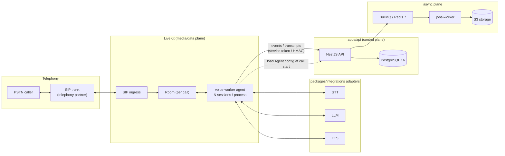
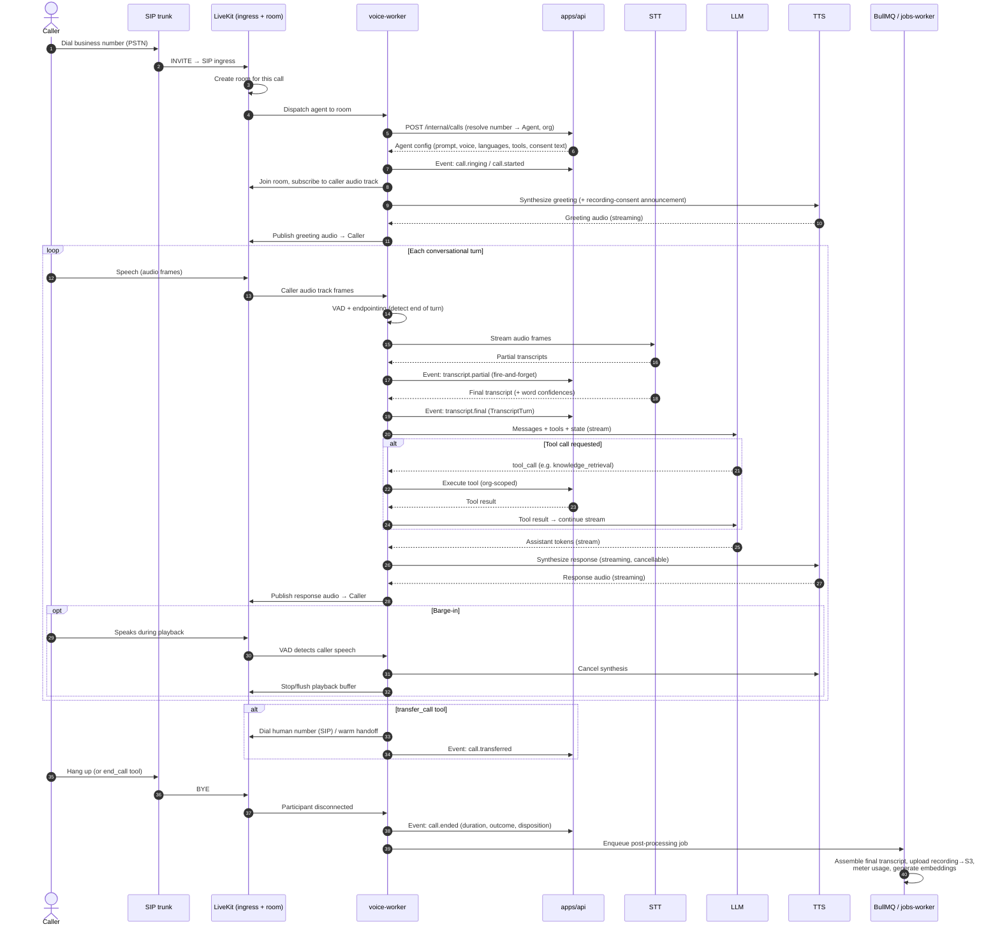
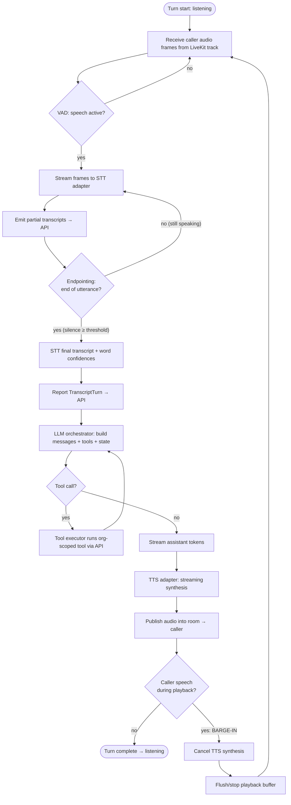
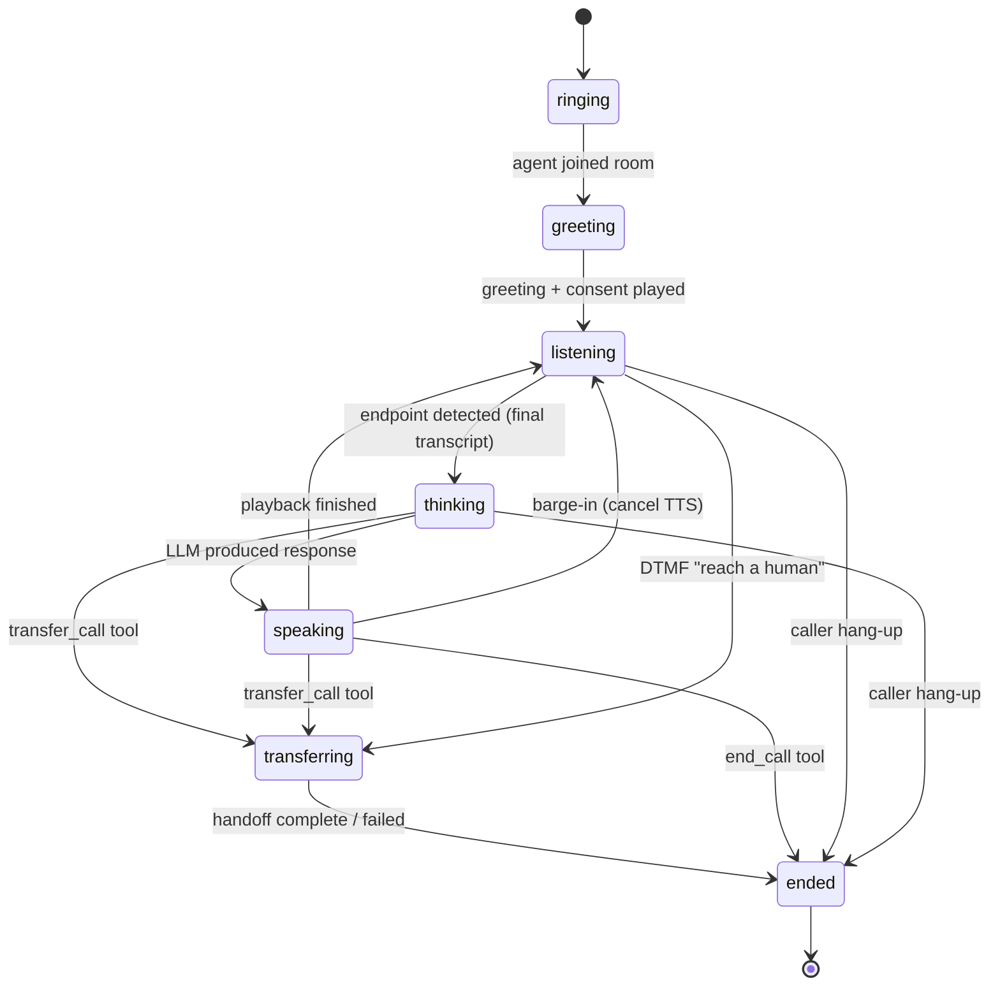

# OvozAI — Voice Pipeline

> Real-time voice architecture for the OvozAI AI Voice Receptionist.
> How a phone call becomes a conversation, turn by turn, under a ~1.5s latency budget.

**Audience:** engineers working on `apps/voice-worker`, `packages/integrations`, and `apps/api`.
**Status:** design specification (greenfield). Concrete providers land in Phase 4 — see [ROADMAP.md](./ROADMAP.md).

**Related documents**

- [ARCHITECTURE.md](./ARCHITECTURE.md) — monorepo layout, apps, deployment topology.
- [DATABASE.md](./DATABASE.md) — `Call`, `Transcript`, `TranscriptTurn`, `Agent`, `Organization` schemas.
- [API.md](./API.md) — control-plane REST/RPC surface and the internal voice-worker ↔ API channel.
- [SECURITY.md](./SECURITY.md) — recording consent, data residency, service-token/HMAC auth, PII handling.
- [ROADMAP.md](./ROADMAP.md) — phase-by-phase delivery plan.

---

## 1. Overview

OvozAI answers inbound phone calls with an AI voice agent that speaks Uzbek, Russian, and
English, answers from a tenant knowledge base, books appointments, and transfers to a human
when needed. The system is split into two planes that are intentionally kept apart:

| Plane | App | Responsibility | Lifetime |
| --- | --- | --- | --- |
| **Control plane** | `apps/api` (NestJS 12 modular monolith) | Tenancy, auth, agent configuration, persistence, billing/usage, dashboards, webhooks. Owns PostgreSQL 16 and the source of truth. | Long-lived request/response service. |
| **Media / data plane** | `apps/voice-worker` (LiveKit agents framework) | Joins a LiveKit room per call, carries live audio, runs the VAD → STT → LLM → TTS loop, executes LLM tools, reports events. | One long-lived process hosting **N** concurrent call sessions. |
| **Async plane** | `apps/jobs-worker` (BullMQ on Redis 7) | Post-call work: final transcript assembly, recording upload to S3, usage metering, embedding generation. | Queue consumers. |

The voice-worker is deliberately **stateless with respect to tenant data**: it loads an
`Agent` config (tenant-scoped) at call start from the control plane, holds per-call state in
memory for the duration of the call, and persists nothing directly to the primary database.
Everything durable flows back through the API over an authenticated internal channel (service
token / HMAC — see [SECURITY.md](./SECURITY.md#authentication)) or onto a BullMQ queue. This
keeps the real-time path free of database write latency and keeps a single write authority.



---

## 2. Full inbound call — sequence

A complete inbound call from ring to teardown. Partial/final transcripts and lifecycle events
stream to the API throughout; heavy post-processing is deferred to the jobs-worker.



---

## 3. Per-turn processing loop

The inner loop that runs for every caller turn. The barge-in path is the key real-time
concern: caller speech detected during TTS playback must cancel synthesis and flush buffered
audio immediately.



---

## 4. Voice-worker internal architecture

One `apps/voice-worker` process hosts many independent **call sessions**. Each session owns its
own state machine, provider streams, and in-memory conversation state; sessions share only the
provider connection pools and the process-level event reporter.

### 4.1 Components

- **Session Manager** — accepts agent dispatch from LiveKit, creates a `CallSession` per room,
  tracks the active session set (used for autoscaling signals), and tears sessions down on
  disconnect. Enforces per-process concurrency limits and backpressure.
- **Audio I/O** — subscribes to the caller's inbound audio track, decodes frames, and feeds the
  VAD/STT path; publishes a synthesized outbound track from TTS. Manages jitter buffering, frame
  resampling, and the playback buffer that barge-in flushes. Opus preferred, G.711 fallback.
- **VAD / Turn Detector** — voice activity detection plus endpointing. Decides when the caller
  has started speaking (gate STT, detect barge-in) and when a turn has ended (silence threshold +
  optional semantic turn detection) so the LLM is not triggered mid-sentence.
- **Streaming Orchestrator** — the STT → LLM → TTS pipeline coordinator. Owns the streaming
  contract: it pumps STT finals into the LLM, streams LLM tokens into the TTS adapter as they
  arrive (speculative/early synthesis), and manages cancellation tokens so a barge-in or a new
  turn aborts in-flight LLM and TTS work cleanly.
- **Tool Executor** — resolves LLM tool calls to concrete actions. All tools execute against the
  control plane over the authenticated internal channel and are **organization-scoped**; the
  executor injects `organizationId` and `callId` and never trusts an org id from model output.
- **State Machine** — drives the call through its lifecycle (below) and gates which inputs are
  acted upon in each state.
- **Event Reporter** — buffers and ships lifecycle events + transcripts to the API (service
  token / HMAC), and enqueues the post-processing job on call end. Reporting is idempotent
  (event id + call id) so retries after transient failures do not double-count.

### 4.2 Call state machine



| State | Meaning | Primary inputs acted on |
| --- | --- | --- |
| `ringing` | Call accepted, agent being dispatched, config loading. | — |
| `greeting` | Playing greeting + recording-consent announcement. | barge-in only |
| `listening` | Awaiting/collecting caller speech; VAD + STT active. | audio, DTMF |
| `thinking` | LLM orchestrating a response, possibly running tools. | cancel on new speech |
| `speaking` | TTS playing back into the room. | barge-in (cancel) |
| `transferring` | Warm/cold handoff to a human number in progress. | transfer status |
| `ended` | Teardown; final event + enqueue post-processing. | — |

### 4.3 How a session reports to the control plane

The session never writes to PostgreSQL directly. It emits two classes of signal:

1. **Real-time events** over the internal channel (low latency, fire-and-forget with retry):
   `call.ringing`, `call.started`, `transcript.partial`, `transcript.final`, `tool.invoked`,
   `call.transferred`, `call.ended`. The API persists what matters (e.g. a `TranscriptTurn` per
   final; see [DATABASE.md](./DATABASE.md)) and fans out to tenant webhooks.
2. **Deferred work** onto BullMQ at call end: final transcript assembly, recording upload to S3,
   usage metering, embedding generation for RAG. See §9 and [ARCHITECTURE.md](./ARCHITECTURE.md).

---

## 5. Provider-agnostic adapter interfaces

All STT, LLM, and TTS access goes through interfaces defined in `packages/integrations`. The
voice-worker depends only on these interfaces, never on a vendor SDK directly. This is what makes
providers swappable, chainable (fallback/racing), and testable. **Phase 4 ships one concrete
implementation of each**; additional providers and fallback chains follow. See
[ROADMAP.md](./ROADMAP.md).

> The blocks below are **documentation sketches** of the interface shapes — not source files.
> TypeScript 5.9.3; runtime contracts validated with zod 4.6 at the adapter boundary.

### 5.1 `SttProvider`

```typescript
// Streaming speech-to-text. Partial results flow continuously; finals carry
// word-level confidences and are the unit persisted as a TranscriptTurn.
interface SttProvider {
  readonly name: string;
  readonly supportedLanguages: string[]; // e.g. ["uz", "ru", "en"]

  openStream(opts: {
    organizationId: string;
    callId: string;
    sampleRate: number;             // e.g. 16000
    encoding: "opus" | "pcm16" | "mulaw";
    languageHints?: string[];       // per-agent config; bias for code-switching
    customVocabulary?: string[];    // boosting: brand/menu/location terms
    interimResults?: boolean;       // emit partials
  }): SttStream;
}

interface SttStream {
  pushAudio(frame: Uint8Array): void;
  flush(): void;                    // signal end-of-utterance hint
  close(): Promise<void>;

  onPartial(cb: (r: SttResult) => void): void;
  onFinal(cb: (r: SttResult) => void): void;
  onError(cb: (e: ProviderError) => void): void;
}

interface SttResult {
  text: string;
  isFinal: boolean;
  language?: string;                // detected language for this segment
  confidence?: number;              // 0..1 utterance-level
  words?: Array<{ word: string; start: number; end: number; confidence: number }>;
}
```

### 5.2 `LlmProvider`

```typescript
// Streaming chat completion with tool/function calling. The orchestrator consumes
// the token stream and begins TTS before the full message is complete.
interface LlmProvider {
  readonly name: string;

  chatStream(req: {
    organizationId: string;
    callId: string;
    messages: ChatMessage[];        // system (Agent prompt) + conversation state
    tools?: ToolSchema[];           // the tool catalog (see §7)
    temperature?: number;
    maxTokens?: number;             // keep first response short for latency
    signal?: AbortSignal;           // cancel on barge-in / new turn
  }): AsyncIterable<LlmChunk>;
}

type LlmChunk =
  | { type: "text"; delta: string }
  | { type: "tool_call"; id: string; name: string; argsDelta: string }
  | { type: "done"; finishReason: "stop" | "tool_calls" | "length" | "error" };

interface ChatMessage {
  role: "system" | "user" | "assistant" | "tool";
  content: string;
  toolCallId?: string;
}
```

### 5.3 `TtsProvider`

```typescript
// Streaming synthesis. Must support mid-stream cancellation so barge-in can
// stop playback immediately without waiting for the full audio to render.
interface TtsProvider {
  readonly name: string;
  readonly supportedLanguages: string[];

  synthesizeStream(opts: {
    organizationId: string;
    callId: string;
    text: AsyncIterable<string> | string; // accept token stream for early synthesis
    voice: string;                         // per-agent voice id
    language: string;                      // "uz" | "ru" | "en"
    sampleRate: number;
    encoding: "opus" | "pcm16" | "mulaw";
    signal?: AbortSignal;                  // barge-in cancellation
  }): AsyncIterable<AudioChunk>;
}

interface AudioChunk { data: Uint8Array; isFinal: boolean; }
```

### 5.4 Chaining, fallback, and racing

`packages/integrations` also exposes composition helpers so a logical provider can be built from
several concrete ones:

- **Fallback chain** — try provider A; on timeout/error, transparently fail over to B.
- **Racing** — for the hardest case (Uzbek STT), dispatch to two providers in parallel and take
  the first acceptable final (by latency + confidence). Costs more; used selectively per agent.
- **Per-language routing** — route `uz` to the provider with the best measured WER, `ru`/`en`
  elsewhere, driven by the Agent's language config.

```typescript
interface ProviderError { code: "timeout" | "rate_limit" | "auth" | "unavailable" | "bad_request"; retryable: boolean; message: string; }
```

---

## 6. Turn-taking, endpointing, barge-in, and DTMF

### 6.1 Turn-taking and endpointing

Endpointing decides *when the caller has finished speaking* so the LLM is triggered on a complete
utterance rather than mid-sentence. The turn detector combines:

- **Silence duration** — a configurable trailing-silence threshold (e.g. ~500–800ms) after VAD
  goes inactive. Shorter feels snappy but risks cutting people off; longer feels sluggish.
- **STT stability** — treat a final (or a stable partial that stops changing) as a strong
  end-of-turn signal.
- **Optional semantic turn detection** — a lightweight model/heuristic that distinguishes a pause
  ("I'd like to book... for Tuesday") from a true end of turn, to reduce premature triggering.

Endpointing thresholds are tunable per agent and per language, because pacing differs across
Uzbek/Russian/English and across dialects.

### 6.2 Barge-in and interruption

While in `speaking`, the VAD keeps running on the inbound track. When the caller starts speaking:

1. VAD flags caller speech during playback (barge-in).
2. The orchestrator fires the `AbortSignal` on the in-flight TTS synthesis (and any still-running
   LLM stream for that turn).
3. Audio I/O **flushes the playback buffer** immediately so the agent goes quiet at once.
4. State returns to `listening`; the new caller audio starts a fresh turn.

A short debounce / minimum-speech-energy gate avoids false barge-ins from coughs, line noise, or
backchannel ("aha", "ha"). Because TTS is streamed and cancellable, only a small amount of
already-buffered audio can play after barge-in; keeping the playback buffer small bounds this.

### 6.3 DTMF

DTMF (keypad tones) arrive as events from LiveKit SIP, not as audio to transcribe. They are
handled out-of-band by the session:

- **Menu / IVR-style capture** — digits map to agent-configured intents (e.g. press `1` for
  Russian, `2` to reach a human).
- **Collecting structured input** — digit sequences (phone numbers, confirmation codes) are more
  reliable via DTMF than STT and bypass the STT path entirely.
- **Immediate transfer** — a configured "reach a human" key can move the call to `transferring`
  from any interactive state.

DTMF digits are PII-adjacent (they may be phone numbers); they are redacted in logs per
[SECURITY.md](./SECURITY.md#auditing--logging).

---

## 7. LLM tool / function catalog

Tools are passed to the LLM as function schemas and executed by the Tool Executor against the
control plane. Every tool is **organization-scoped**: the executor injects `organizationId` and
`callId` server-side and ignores any org/tenant identifier the model might emit. Argument shapes
below are indicative.

| Tool | Purpose | Rough arguments |
| --- | --- | --- |
| `knowledge_retrieval` | RAG over the agent's knowledge base to answer questions. | `{ query: string, topK?: number, language?: string }` |
| `check_availability` | Look up open appointment slots via the calendar adapter. | `{ serviceId?: string, from: string, to: string, staffId?: string }` |
| `book_appointment` | Create an appointment for the caller. | `{ slotId: string, customerName: string, phone: string, serviceId?: string, notes?: string }` |
| `transfer_call` | Warm or cold transfer to a human number. | `{ target: string, mode: "warm" \| "cold", reason?: string }` |
| `end_call` | Politely end the call when the goal is complete. | `{ reason?: string, disposition?: string }` |

```typescript
interface ToolSchema {
  name: string;
  description: string;
  parameters: JsonSchema; // zod-derived; validated before execution
}
```

Notes:

- `knowledge_retrieval` queries only the calling organization's indexed documents/embeddings;
  retrieval is tenant-scoped at the data layer (see [DATABASE.md](./DATABASE.md) and
  [SECURITY.md](./SECURITY.md#multi-tenant-isolation)).
- `book_appointment` / `check_availability` go through the calendar adapter in
  `packages/integrations`; results are reflected to the dashboard via the API.
- `transfer_call` **warm** mode briefs/announces to the human before bridging; **cold** mode
  bridges directly. Both may be used as a graceful failure path (see §9).
- `end_call` moves the machine to `ended`; teardown and post-processing follow.

---

## 8. Recording & transcript handling

### 8.1 Recording

- The call may be recorded (per agent/tenant policy and legal basis — see
  [SECURITY.md](./SECURITY.md#uzbekistan-compliance)). Recording is captured at the media layer.
- A **recording-consent announcement** is played as part of the greeting (two-party consent):
  the caller is told the call may be recorded before substantive conversation begins. The
  announcement text is part of the Agent config and localized per language.
- On call end, the recording is uploaded to **S3-compatible storage** by the jobs-worker. The
  resulting **object key is stored on the `Call`** record (not the audio blob itself). Keys are
  tenant-scoped (e.g. prefixed by `organizationId`) — see
  [SECURITY.md](./SECURITY.md#multi-tenant-isolation).

### 8.2 Transcripts

- During the call, each STT **final** is reported to the API as a `TranscriptTurn`
  (speaker = caller/agent, text, timing, language, confidence). See the `Transcript` /
  `TranscriptTurn` tables in [DATABASE.md](./DATABASE.md).
- At call end, the jobs-worker assembles the ordered **final transcript** (merging turns,
  normalizing timings) and links it to the `Call`.
- Transcripts and recordings are **sensitive PII** and governed by retention/deletion and data
  residency rules in [SECURITY.md](./SECURITY.md).

---

## 9. Uzbek-language handling strategy

Uzbek STT quality is the single biggest product risk. Uzbek is low-resource, has few
high-quality providers, exhibits frequent Uzbek↔Russian **code-switching**, and has dialectal
variation. This is treated as a **first-class, measured concern**, not an afterthought.

**Strategy**

1. **Multi-provider adapters with fallback / racing.** The `SttProvider` interface lets us run
   more than one provider for the hard case: fail over on error/timeout, or race two providers in
   parallel and take the first acceptable final by latency + confidence (§5.4). The best provider
   for Uzbek may differ from the best for Russian/English.
2. **Custom vocabulary / boosting.** Pass tenant-specific terms (brand names, menu items,
   service names, neighborhoods, staff names) via `customVocabulary` to improve recognition of
   the words that matter for each business.
3. **Per-agent language configuration.** Each `Agent` declares its expected languages and
   `languageHints`; a single-language clinic and a bilingual restaurant can be tuned differently.
   Language hints bias STT and route TTS voice selection.
4. **Code-switching handling.** Because callers mix Uzbek and Russian within a sentence, we avoid
   hard single-language locking: hints are biases, STT returns a per-segment `language`, and the
   LLM prompt instructs the agent to respond in the caller's language.
5. **WER measurement per provider / language.** We measure Word Error Rate per provider, per
   language, and per dialect on held-out call samples, and feed that back into routing decisions.
   WER is the KPI that decides which provider wins for `uz`.
6. **A path to fine-tuning.** The architecture keeps room for a fine-tuned or custom Uzbek model
   behind the same `SttProvider` interface once enough labeled call data exists — no changes to
   the voice-worker required.

---

## 10. Latency budget

Target: **user-perceived response under ~1.5s** from the moment the caller stops speaking to the
first audio of the agent's reply. The budget is the sum of pipeline stages; streaming overlaps
much of the apparent cost, but the serial critical path must stay within budget.

| Stage | What happens | Target (ms) |
| --- | --- | --- |
| Endpointing | Detect end of caller turn (trailing silence + stability) | 300–500 |
| STT finalization | Convert buffered speech to a final transcript | 100–250 |
| LLM first token | Time to first token (TTFT) from the model | 300–500 |
| TTS first audio | Time to first synthesized audio chunk | 150–300 |
| Network / media | SIP ↔ LiveKit ↔ provider round trips, jitter buffer | 100–200 |
| **Perceived total** | Caller stops → first agent audio | **~1.0–1.5s** |

> These are the first-audio targets. Full LLM completion and full TTS continue streaming *after*
> first audio, overlapped with playback, so they do not add to perceived latency.

**Strategies to hit the budget**

- **Stream everywhere.** STT partials → LLM, LLM tokens → TTS, TTS audio → room. Never wait for a
  full result before starting the next stage.
- **Speculative / early TTS.** Begin synthesizing the first sentence as soon as the LLM produces
  it, rather than waiting for the full completion.
- **Keep the first response short.** Prompt the model to open with a brief utterance; detail can
  follow in a second streamed chunk. Shorter first response = faster first audio and cheaper
  barge-in.
- **Prompt / context caching.** Cache the system prompt and stable knowledge context so repeated
  turns pay less TTFT.
- **Co-locate providers.** Place STT/LLM/TTS endpoints close to the voice-worker region to cut
  round-trip time (bounded by the residency constraint — see §11 and
  [SECURITY.md](./SECURITY.md#uzbekistan-compliance)).
- **Tight, cancellable pipelines.** Small playback buffer + `AbortSignal` so barge-in and new
  turns reclaim latency budget instead of fighting stale work.

---

## 11. Failure modes & resilience

The real-time path must degrade gracefully; a provider hiccup should never leave the caller in
silence. Core principles: **time-bound every provider call, always have a fallback utterance, and
make reporting idempotent.**

| Failure | Detection | Response |
| --- | --- | --- |
| **STT provider timeout / error** | Stream error or no result within budget | Fail over to the next `SttProvider` in the chain; if all fail, play a localized "could you repeat that?" prompt. |
| **STT silence** (no speech detected) | VAD inactive past a max-wait | Re-prompt ("Are you still there?"); after repeated silence, offer transfer or end the call politely. |
| **LLM error / timeout** | Stream error or TTFT past budget | Retry once / fail over provider; otherwise play a graceful fallback message and optionally `transfer_call`. |
| **TTS error / timeout** | Synthesis error or no audio in budget | Fail over `TtsProvider`; last resort, use a pre-rendered fallback clip for the key messages. |
| **Tool execution failure** | API error / timeout | Tell the caller the action can't be completed now; offer human transfer; never fabricate success. |
| **LiveKit / SIP disconnect** | Participant disconnected / room closed | End the session, emit `call.ended` with a failure disposition, enqueue whatever post-processing is possible from buffered data. |
| **Call-transfer-on-failure** | Repeated pipeline failure or explicit policy | Warm/cold `transfer_call` to a configured human number as the safety net. |

**Idempotent event reporting.** Every event carries a stable id (`callId` + event id). The API
deduplicates, so retries after transient network failures do not double-count usage or duplicate
`TranscriptTurn`s. Post-processing jobs are likewise idempotent on `callId`.

**Graceful fallback messaging.** Localized fallback utterances (per language, from Agent config)
cover the "repeat that", "one moment", and "let me connect you to someone" cases so the caller
always hears something sensible even when a provider is down.

---

## 12. Scaling the voice-worker

- **N sessions per process.** A single agent process hosts many concurrent call sessions; memory
  and CPU (audio decode, VAD) are the practical limits, plus provider connection fan-out. The
  Session Manager enforces a per-process cap and applies backpressure at the cap.
- **Autoscale by active sessions.** The scaling signal is *active call sessions* (and headroom),
  not generic CPU. The Session Manager exposes active-session counts for the autoscaler.
- **Warm pools for low cold-start.** Keep a pool of pre-initialized worker processes (SDKs
  connected, models/VAD warmed) so a new call joins a ready process instead of paying cold-start
  latency on the critical path.
- **Region pinning.** Pin workers (and the providers they call) to regions chosen for **(a)**
  media latency to the caller/SIP trunk and **(b)** data residency. For Uzbek citizens' personal
  data this is a hard constraint, not an optimization — primary processing/storage must stay on
  infrastructure located in Uzbekistan (see [SECURITY.md](./SECURITY.md#uzbekistan-compliance)).
- **Graceful drain.** On deploy/scale-in, stop accepting new dispatches to a process but let
  in-flight calls finish before the process exits; never drop a live call for a rollout.

---

## 13. Cross-references

- Monorepo apps, planes, deployment → [ARCHITECTURE.md](./ARCHITECTURE.md)
- `Call`, `Transcript`, `TranscriptTurn`, `Agent`, `Organization` → [DATABASE.md](./DATABASE.md)
- Internal voice-worker ↔ API channel, webhooks → [API.md](./API.md)
- Consent, residency, service-token/HMAC, PII, retention → [SECURITY.md](./SECURITY.md)
- Phase 4 concrete providers and delivery order → [ROADMAP.md](./ROADMAP.md)
